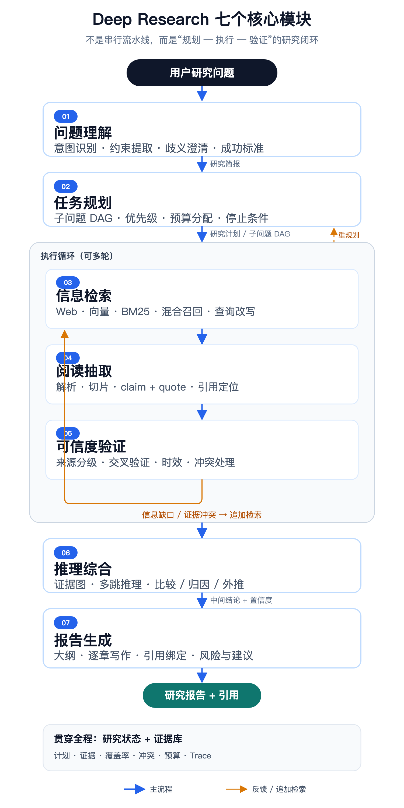

<!--
公众号发布备注（转换后不会显示）：
本文是「Deep Research 技术详解」连载上篇，覆盖 01–03。
建议封面文案：Deep Research（上）/ 不是搜索加总结
正文含 2 处配图建议。
-->

# Deep Research 技术详解（上）：从“搜索 + 总结”到研究型 Agent


> 为什么需要 Deep Research，以及它的 7 个核心模块
>
> 适合读者：有 AI、大模型或后端基础的工程师

你大概见过这样的演示：

输入一个问题，AI 自动搜索十几篇网页，几分钟后吐出一份几千字的报告。排版漂亮，结构完整，看起来非常专业。

但只要多问一句——“这个数字哪来的？”“这两个来源为什么互相矛盾？”“结论的证据链在哪？”——它往往就露馅了。

**这不是 Deep Research，这只是“搜索 + 总结”。**

真正的研究型 Agent，差别不在输出长度，而在它有没有一套**研究状态**：知不知道自己查过什么、还缺什么、哪些结论有争议、下一步该查哪里。

本文从工程视角，把 Deep Research 拆开讲清楚：它由哪些模块组成、每个模块怎么实现、难点在哪、怎么落地、怎么评估。

---

## 先给结论

- Deep Research 的本质，是**面向复杂问题的信息获取、验证、推理与综合系统**，不是“更大的模型 + 更长的 prompt”。
- 它和 RAG 不是替代关系。**RAG 是它的子能力**，负责“从已有资料里找答案”；Deep Research 还要负责“主动出去找、判断可不可信、发现还缺什么”。
- 系统里最重要的中间产物不是聊天记录，而是**结构化证据**：claim、原文引用、来源、时间、置信度。
- 工程上最大的难点不是生成报告，而是**问题拆解、噪声过滤、交叉验证和引用追溯**。
- 没有预算约束的 Agent 不可运营。时间、搜索次数、文档数、Token 必须有硬上限。

---

## 01 | 为什么现在都在做 Deep Research

三个推力同时到位了。

**第一，模型能力跨过门槛。**
长上下文、结构化输出、工具调用、多步指令遵循，这几项能力同时成熟，才让“让模型自己决定下一步查什么”从 demo 变成可工程化的系统。

**第二，成本降下来了。**
一次研究任务可能包含几十次搜索、上百次网页读取、多轮模型调用。靠模型分层——小模型做抽取和分类，大模型做规划和综合——才把成本压到可运营区间。

**第三，需求从“问答”升级成“调研”。**
企业真正要的往往不是一句答案，而是一份包含背景、证据、对比、风险和建议的材料。传统 RAG 擅长回答，但不擅长主动研究。

三者的关系可以用一张表说清：

| 能力 | 解决的问题 | 典型输出 |
|---|---|---|
| 普通搜索 | 哪里有信息 | 链接列表 |
| RAG | 如何用已有资料回答 | 一段答案 |
| Deep Research | 如何完成一项研究 | 带引用的报告 |

一句话：**搜索解决“哪里有”，RAG 解决“怎么喂”，Deep Research 解决“怎么研究”。**

### 它适合什么问题

满足以下任意几条，就值得用 Deep Research：

- 答案不在单一文档里，需要跨来源拼接；
- 信息有时效性，模型参数里的知识已经过时；
- 结论必须可追溯、可验证；
- 不同来源存在冲突，需要判断可信度；
- 输出是报告，不是一句话答案；
- 问题本身有隐含约束，需要澄清或显式假设。

反例也很明确：查天气、改代码、查一条公司报销标准——一次工具调用或一次 RAG 就够，用 Deep Research 是过度设计。

判断标准：**这个问题是否需要“多步获取 + 判断 + 综合”才能回答。**

---

## 02 | 什么才是 Deep Research

先给一个工程视角的定义：

> Deep Research 是一种以大模型为控制器、以外部工具为信息通道、以证据为中心的研究型 Agent。它接收复杂或开放的研究问题，自主完成问题理解、任务规划、多轮检索、文档阅读、证据抽取、交叉验证、推理综合和报告生成，并在明确的预算约束下输出可追溯的研究结论。

四个关键词：

**1. 大模型是控制器。**
模型不只做最后写作，而是参与决策：下一步查什么、读哪篇、要不要追加检索、什么时候停。

**2. 证据为中心。**
中间产物是结构化的证据集合，报告是从证据上“长”出来的，不是凭空生成的。

**3. 多轮且动态。**
检索不是一次性的，计划也不是一成不变的。系统会根据覆盖率、冲突和缺口调整策略。

**4. 预算约束。**
研究是有限资源下的最优停止问题。没有预算约束，Agent 会无限检索。

### 它不是“联网搜索 + 总结”

差别是本质性的：

| 搜索 + 总结 | Deep Research |
|---|---|
| 线性流程：搜 → 拼 → 总结 | 循环：计划 → 执行 → 评估 → 调整 |
| 用户原问题直接搜 | 拆解、改写、扩展、多角度检索 |
| 处理摘要片段 | 抽取结构化证据，保留原文与出处 |
| 不判断可信度 | 来源分级、交叉验证、时效判断 |
| 不知道缺什么 | 显式维护覆盖率与开放问题 |
| 输出一段文字 | 输出报告 + 引用 + 风险 + 建议 |

核心差异只有一句话：**有没有显式的研究状态。**

### 三个例子

**例子一：行业趋势分析**

“分析未来三年 AI 推理芯片行业的竞争格局和技术趋势。”

合格的系统会先澄清范围：全球还是中国、是否包含边缘侧、读者是投资人还是研发。然后拆成市场规模、主要玩家、技术路线、供应链、政策、下游需求等子问题。市场规模数字在不同机构之间差异很大，必须并列呈现口径和假设。

**例子二：开源框架选型**

“调研某开源框架是否适合企业核心交易系统。”

难点不在“介绍框架”，而在约束匹配：许可证是否允许闭源商用、社区活跃度、版本兼容策略、可观测性、权限审计、迁移成本、历史漏洞。

最终输出应该是一张**评分矩阵 + 风险清单 + PoC 建议**，而不是一篇介绍文章。

**例子三：模型选型**

“比较多个 AI 模型在客服场景中的优劣。”

最容易犯的错是拿公开榜单当结论。合格的系统会先明确语言、并发、延迟上限、单次成本、数据是否出境，再区分“公开基准表现”和“业务场景表现”，并说明哪些结论有证据、哪些只是推断。

三个例子的共同点：**问题本身包含大量隐含约束，答案质量取决于是否把约束显式化。**

<!-- 配图建议 1：三栏对比图，搜索 / RAG / Deep Research 的流程差异 -->

---

## 03 | 七个核心模块

一个完整的 Deep Research 系统，通常按数据流分成七层。先看一张总图：



*图 1：七个模块不是串行流水线，而是“规划—执行—验证”的闭环。蓝色实线为主流程，橙色线为反馈与追加检索。*

下面按数据流顺序逐个拆。

### 3.1 问题理解：把“问题”变成“需求文档”

这是整个系统的需求文档，后续所有模块都依赖它。

要做四件事：

1. **归一化**：统一术语、缩写、中英文、时间表达。
2. **意图识别**：事实查询、比较评估、因果分析、趋势预测、尽调、争议梳理。
3. **约束提取**：时间范围、地域、行业、对象、预算、读者、来源限制、合规要求。
4. **歧义检测**：判断是追问，还是假设并显式声明。

一份结构化的研究简报至少包含：

- 规范化后的问题
- 意图类型
- 约束条件（时间、地域、部署方式、规模、合规）
- 显式假设
- 待澄清项及默认值
- 成功标准

**关键策略：只对影响结论走向的约束追问，其余采用默认值并写进 assumptions。**

每次都追问会毁掉体验；不追问又容易答偏。折中点是：把假设摆到明面上，让用户有机会纠正。

> **坑**：过度追问、约束互相冲突、把“企业级”这类隐含要求漏掉。后者需要领域知识库，把“企业级”展开成高可用、审计、权限、SLA 等检查项。

### 3.2 任务规划：决定研究的上限

Planner 把研究目标转换成可执行的任务图，通常是 DAG。

**常见拆解维度**：

- 按分析框架：PEST、SWOT、波特五力、技术成熟度曲线；
- 按对象：玩家、产品、技术路线、供应链、政策、客户；
- 按证据类型：事实、数据、观点、预测、反例；
- 按时间：历史、现状、趋势、情景；
- 按验证需求：必须一手来源的、可交叉验证的、可接受二手的。

**一个好子问题的标准**：可检索、可验证、粒度适中、有优先级。

计划建议用显式结构表示，而不是藏在 prompt 里：

```json
{
  "goal": "评估 X 是否适合企业级落地",
  "sub_questions": [{
    "id": "q1",
    "question": "许可证是否允许闭源商用？",
    "priority": "P0",
    "depends_on": [],
    "success_criteria": "找到 LICENSE 文件",
    "budget": {"searches": 3, "reads": 5}
  }],
  "stop_conditions": [
    "P0 子问题均有至少两个独立来源",
    "剩余预算低于 15%",
    "连续两轮无新增有效证据"
  ]
}
```

**什么时候重规划**：

- 覆盖率不足，某个 P0 子问题还没可靠证据；
- 发现高可信来源之间互相矛盾；
- 检索中出现原计划没覆盖的关键方向；
- 连续多轮收益递减；
- 预算预警，需要裁剪优先级。

工程上优先做**局部修补**，而不是全局重写。全局重写容易把已经完成的工作丢掉。

**Planner 的真正作用**，是把“探索”变成“有方向的探索”。没有它，Agent 容易原地打转、过早收敛、预算失控。它还负责定义“什么算完成”——没有停止条件，Agent 要么停太早，要么停不下来。

> **坑**：拆解质量不稳定、粒度过细导致调用爆炸、子问题形成循环依赖、重规划丢失上下文。解法是领域模板 + 结构化校验 + 计划持久化。

### 3.3 信息检索：多路召回，而不是一次搜索

四条通道各有用处：

- **Web Search**：公开信息、最新动态；
- **向量检索**：语义匹配、私有知识库、多语言；
- **关键词检索**：专有名词、产品型号、法规编号、错误码；
- **结构化查询**：财务数据、指标、日志等精确数据。

实践中最稳的是混合检索：

1. BM25 和向量各召回 Top-K；
2. 用 RRF 融合排名；
3. 用 cross-encoder 或 LLM 重排；
4. 取 Top-N 进入阅读阶段。

RRF 的公式很简单：

```text
RRF_score(d) = Σ 1 / (k + rank_i(d))
```

其中 `k` 通常取 60 左右，`rank_i(d)` 是文档在第 i 路召回中的排名。

**查询改写**是提升召回的关键：

| 方法 | 作用 | 适用场景 |
|---|---|---|
| 同义扩展 | 加同义词、缩写、英文对照 | 术语不统一 |
| 查询分解 | 复合问题拆成单跳查询 | 多实体比较 |
| Step-back | 先问更抽象的背景问题 | 缺领域知识 |
| HyDE | 先生成假设答案再检索 | 措辞差异大 |
| 时间限定 | 加年份、季度、latest | 时效性要求高 |
| 站点限定 | 限定官网、财报、法规库 | 需要一手来源 |
| 否定查询 | 加 limitation、failure | 找反面证据 |

**多轮检索的常见策略**：

- 由宽到窄：先搜综述建骨架，再搜细节；
- 由窄到宽：先锁定关键事实，再补背景；
- 正反交替：查完支持证据，专门查反面案例；
- 来源升级：从二手报道追溯到一手来源；
- 时间递进：历史、最新、预测。

> **坑**：查询漂移、结果同质化、付费墙、时效性差。要保留原始问题作为锚点，维护查询历史，按域名和内容指纹去重。

### 3.4 阅读与抽取：把网页变成证据

这是最“脏活累活”的模块，也是决定证据质量的关键。

典型流水线：

1. **抓取**：HTTP 请求，必要时用无头浏览器渲染 JS；
2. **正文提取**：去掉导航、广告、评论、页脚；
3. **结构化解析**：标题层级、表格、列表、代码块；
4. **元数据提取**：作者、发布时间、更新时间、站点、语言；
5. **切片**：标题感知，每片 300–800 tokens，重叠 10%–15%。

一个证据条目至少包含：

```json
{
  "evidence_id": "ev_00123",
  "claim": "X 在 100M 向量下 P99 延迟约 45ms",
  "quote": "在 100M 向量、200 QPS 的压测中……",
  "source_url": "https://example.com/x",
  "published_at": "2026-03-12",
  "retrieved_at": "2026-11-16T10:32:00Z",
  "span": {"start": 1024, "end": 1108},
  "source_type": "primary",
  "confidence": 0.86
}
```

四个设计要点：

- **claim 与 quote 分离**：claim 是规范化陈述，quote 是原文片段。分开才能做蕴含验证。
- **保留 span**：字符偏移或段落 ID，用于引用定位和人工复核。
- **保留时间**：发布时间判断时效，抓取时间判断可复现性。
- **保留来源类型**：一手、二手、三手，官方、媒体、社区、个人。

**引用要贯穿全链路**：抓取记录 URL → 解析记录正文位置 → 切片记录偏移 → 抽取记录 quote 偏移 → 报告绑定 evidence_id。任何一环丢失位置，引用都会退化成“大概来自某个网页”。

> **坑**：JS 渲染、PDF 表格、反爬、多语言、转载去重，以及最危险的**抽取幻觉**——模型总结出原文没有的数字。必须要求 quote 逐字出现在原文中，否则丢弃。

### 3.5 可信度验证：系统的免疫层

这一步是 Deep Research 和普通搜索摘要的分水岭。

**来源可信度**建议多维度打分，而不是一个黑盒分数：

- 来源类型：一手、二手、三手；
- 域名权威性：政府、标准组织、期刊、厂商官网；
- 作者资质：是否可识别、是否有机构署名；
- 引用质量：是否引用了一手来源；
- 时效性：是否在有效期内；
- 利益相关：是否是厂商自评、软文、竞品对比。

**交叉验证的关键是独立性。** 两个站点互相转载，不算两个证据。判断独立性要看：域名是否不同、内容是否高度相似、是否引用同一个原始来源、发布机构是否关联。

一个实用流程：

1. 对关键 claim 检索 2–3 个独立来源；
2. 用 NLI 模型判断每个来源是支持、矛盾还是中立；
3. 按可信度和独立性加权；
4. 支持占优记高置信，矛盾占优记“存在争议”，证据不足记“待验证”。

**冲突不一定是坏事，它往往是有价值的信息。** 处理方式：

- 并列呈现不同说法和口径；
- 按可信度加权，一手优先；
- 按时间优先，新版本压过旧版本；
- 无法判断时明确说“存在争议”，不要强行选一个；
- 关键冲突触发额外检索或人工复核。

**幻觉的四个来源**：

1. 检索不到就编；
2. 抽取时改写原文数字；
3. 综合时把相关当因果；
4. 引用错配，引用了 A 但内容来自 B。

对应四道控制：

- 强制每个事实句绑定 evidence_id；
- claim 必须能被 quote 蕴含；
- 生成阶段禁止引入证据库之外的具体数字；
- 生成后逐条回链校验引用。

> **坑**：可信度分数过度自信、SEO 垃圾内容、多个站点循环引用造成“虚假共识”、逐条验证成本高。解法是分层抽样验证 + 规则与模型结合。

### 3.6 推理与综合：从摘要到洞察

Deep Research 的推理通常是多跳的。例如：

```text
X 的许可证是 Apache 2.0
→ Apache 2.0 允许闭源商用
→ 但 X 的企业功能采用单独商业许可
→ 所以“整体可闭源商用”需要限定范围
```

直接让模型做 Chain-of-Thought 会碰到四个问题：推理不可审计、长链条漂移、无法中途插检索、难以复用和评估。

工程上更常用**结构化推理**：

1. **证据表推理**：把证据整理成表，按来源、时间、数值、口径对比；
2. **Plan-Execute-Verify**：先写推理计划，再逐步执行，每步用证据验证；
3. **Self-Consistency**：关键结论多次采样，不一致的进入复核；
4. **Verifier 模型**：用独立调用检查结论是否被证据支持；
5. **正反辩论**：两个角色分别支持正反观点，裁判模型总结分歧。

共同点是：**把推理过程外化成可检查的中间产物**，而不是依赖隐式思维链。

结论建议用“论点—论据—限定”三段式：

```json
{
  "claim": "X 适合作为企业级 RAG 的向量检索层",
  "support": ["ev_001", "ev_007"],
  "counter": ["ev_021"],
  "conditions": [
    "向量规模在 100M 以内",
    "团队具备 Kubernetes 运维能力",
    "可接受社区版缺少部分企业功能"
  ],
  "confidence": "medium-high"
}
```

这样写的好处：结论可追溯、反面证据不会被藏起来、限定条件明确、置信度能传给报告。

**摘要回答“发生了什么”，洞察回答“这意味着什么”。** 从摘要到洞察，通常要走完归纳、比较、归因、外推、反事实、行动含义六步。

一个实用检查：报告里至少要有**一个非显而易见的结论**，以及支撑它的证据链。如果通篇都是“X 很重要”“市场在增长”，那只是摘要，不是研究。

> **坑**：证据太多导致注意力稀释、推理漂移、过度推断、相关当因果。解法是证据筛选与聚类、结构化模板、强制标注置信度。

### 3.7 报告生成：从证据到可读文本

推荐“先大纲、后章节、再校验”：

1. 根据研究计划和证据覆盖生成大纲；
2. 每章只使用相关证据，避免上下文过载；
3. 检查术语、数字、结论的全局一致性；
4. 逐条校验引用；
5. 做格式和读者适配。

**引用规则**：

- 每个事实性句子至少一个引用；
- 关键数据标注口径和时间；
- 低置信结论标注“证据有限”；
- 提供证据附录，列出原文片段。

一份合格报告通常包含：执行摘要、背景与范围、分析正文、风险与不确定性、建议、附录。

**读者适配不是改语气，而是重排信息优先级：**

| 读者 | 报告重点 |
|---|---|
| 高管 / 投资人 | 结论、风险、决策含义，短，结论前置 |
| 工程团队 | 实现差异、约束、迁移成本、PoC 清单 |
| 法务 / 合规 | 条款、判例、法域，精确引用，保守表述 |
| 产品 / 市场 | 用户需求、竞品、定位、机会点 |

> **坑**：引用漂移、章节重复、模型倾向写长、多章节语气不一致、把推测写成事实。解法是生成时绑定 evidence_id、全局大纲、字数预算、最终一致性检查。

<!-- 配图建议 2：七模块架构图，控制面 / 数据面 / 支撑面 -->

---

*下一篇，我们先把它和 RAG 的边界划清，再把这七个模块串成一条完整的执行链路：13 步分别做什么、会在哪里翻车，以及一套可落地的架构与伪代码。*
