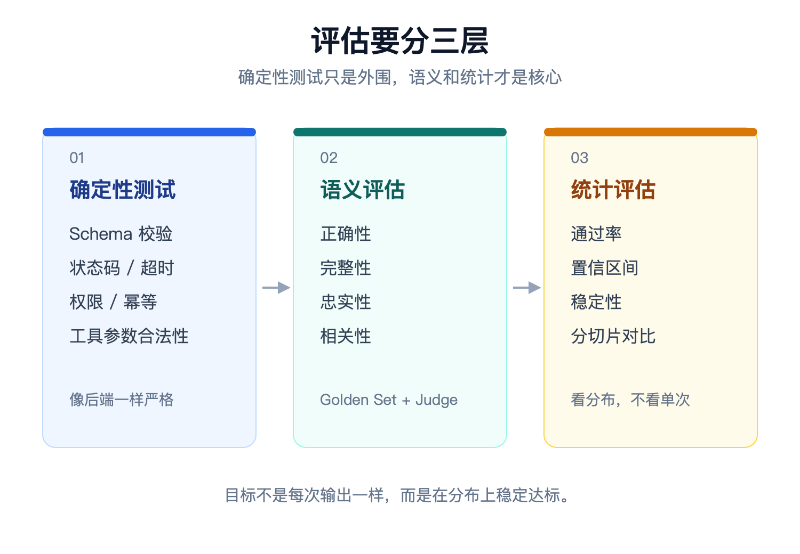
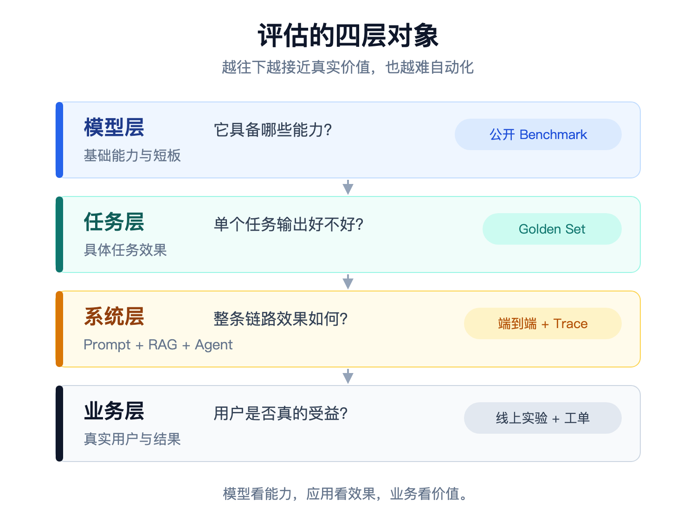

# 大模型评估（一）：为什么“感觉不错”不能作为上线依据

> 输出不确定、传统测试失效，以及评估到底在评什么

很多团队做大模型应用，第一版 demo 往往很惊艳。再加几个 Prompt，接上知识库，看起来就能用了。

但一到上线评审，问题就来了：

- 换个问法，答案就变了，怎么证明它稳定？
- 两个模型都能答，贵三倍的那个到底好多少？
- 回答看起来对，引用却是错的，算不算达标？
- 用户投诉之前，我们能不能自己发现质量退化？

这些问题，靠“我试了一下，感觉不错”回答不了。

这个系列想讲清楚一件事：**大模型评估不是跑几个 Benchmark、看一个分数，而是一套贯穿选型、开发、上线和运营的工程体系。**

第一篇先回答三个问题：为什么必须评、到底评什么、为什么这么难。

## 01 | 一个真实的上线评审

假设你要上线一个企业内部知识库问答系统，用户是客服和运营。

数据源包括产品文档、FAQ、历史工单和制度文件。

上线评审时，下面这些问题必须被回答：

| 评估项 | 指标 | 示意门槛 |
| --- | --- | --- |
| 回答正确 | Answer Correctness | ≥ 85% |
| 忠于资料 | Faithfulness | ≥ 0.90 |
| 引用可信 | Citation Accuracy | ≥ 90% |
| 该拒就拒 | Refusal Accuracy | ≥ 90% |
| 高危安全 | 攻击成功率 | 0 |
| 响应时间 | P95 延迟 | ≤ 4 秒 |
| 单次成本 | 元/成功任务 | ≤ 0.05 |

注意，这不是一个指标，而是一组相互制约的指标。

准确率达标但引用全错，客服不敢用；引用都对但 P95 延迟 15 秒，客服不想用；一切正常但单次成本太高，只能停留在试点。

**评估的产出不是“好不好”，而是“在哪些维度上、以多大代价、达到什么水平”。**

这些门槛也不是拍脑袋定的，而是从业务后果倒推：

- 对外承诺类问题，容错低。
- 闲聊类问题，容错高。
- 涉及权限和隐私的样本，宁可拒答，也不能猜。

门槛应该在试点期用真实数据校准，然后写进上线制度。

## 02 | 输出不确定，测试不能只靠断言

传统后端系统里，同样的参数会返回同样的结果。

大模型不是这样。它是一个概率模型：

- 同一个问题问十次，可能得到十个措辞不同的答案。
- 改一句 Prompt，输出格式和侧重点可能全变。
- 换一个模型版本，某些能力提升，某些边界却回退。
- 检索索引、工具 API、网页结构一变，最终结果也跟着变。

| 变化来源 | 典型影响 | 工程后果 |
| --- | --- | --- |
| 采样参数 | 温度高更发散 | 必须固定并记录参数 |
| Prompt 措辞 | 格式和重点漂移 | 每次修改都要回归 |
| 上下文顺序 | 关键信息被淹没 | 要评估上下文利用率 |
| 模型升级 | 能力不是全面上涨 | 升级前必须跑回归集 |
| 外部环境 | 检索和工具结果变化 | 必须记录链路 Trace |

除了不确定，模型还会出现几类典型问题：

- **幻觉**：编造事实、数据、法条或引用。
- **遗漏**：漏掉关键约束或关键步骤。
- **过度自信**：信息不足时仍给出确定语气。
- **格式错误**：要求 JSON，却输出带注释的伪 JSON。
- **越权与注入**：被恶意指令带偏，执行了不该执行的动作。

这些问题大多不会让程序抛异常。

系统正常返回 200，日志没有报错，只有用户看到一个语气自信但内容错误的答案。

**这类“静默失败”，比显式报错更难发现，也更需要专门的评估手段。**

传统测试并没有失效，只是需要分层：

1. **确定性测试**：Schema、状态码、权限、超时、幂等。
2. **语义评估**：正确性、完整性、忠实性、相关性。
3. **统计性评估**：看样本集上的通过率和置信区间。

*图 2：确定性测试、语义评估、统计评估，三层各司其职。*

换句话说，目标不是“证明每次输出都一样”，而是“证明在给定分布下，质量稳定高于一条可接受的基线”。

## 03 | 没有评估体系，会发生什么

**第一，模型选型没有依据。**

只看榜单、价格或同事推荐。榜单考的是通识与推理，和“能否稳定输出内部工单格式的 JSON”是两件事。

**第二，Prompt 优化不可量化。**

这次回答看起来更顺眼，就合并上线；过两天另一个场景坏了，又改回去。没有回归集，Prompt 会在一轮轮局部优化中积累隐性退化。

**第三，RAG 和 Agent 难以迭代。**

RAG 答错了，可能是解析、切分、Embedding、检索、重排、拼接或生成中任一环出错。没有分阶段指标，只能靠猜。

Agent 也一样：任务失败，可能是规划错、工具选错、参数错，或者只是环境超时。

**第四，上线后质量不可控。**

没有线上监控和失败回流，问题只能靠用户投诉发现。投诉率低，不等于质量好，很多用户遇到错误会直接放弃。

**第五，成本、延迟与安全无法平衡。**

想更准，可以换更大模型、检索更多文档、让 Judge 多轮校验。但每一项都会推高延迟和成本。

没有评估，就无法判断“多花 30% 成本换 2 个点准确率”值不值。

## 04 | 评估到底在评什么

评估不是一个指标，而是四层对象：

| 层级 | 评什么 | 典型数据 |
| --- | --- | --- |
| 模型层 | 基础能力与短板 | 公开 Benchmark |
| 任务层 | 单任务输出质量 | Golden Set |
| 系统层 | 整条链路的效果 | 端到端评估集 |
| 业务层 | 真实用户与结果 | 线上实验、工单 |

*图 1：评估分四层，越往下越接近真实价值。*

模型层看能力覆盖，任务层看任务效果，系统层看 Prompt、RAG、Agent 和工具链，业务层看用户是否真的受益。

基础模型能力可以拆成几个维度：

| 能力 | 代表基准 | 业务含义 |
| --- | --- | --- |
| 通识知识 | MMLU、C-Eval | 知识底座 |
| 数学推理 | GSM8K、MATH | 报表与规则推导 |
| 代码能力 | HumanEval、MBPP | 代码助手、SQL |
| 事实性 | TruthfulQA | 不跟着谣言胡说 |
| 常识推理 | HellaSwag、BBH | 多步判断 |
| 长上下文 | LongBench、RULER | 合同、长报告 |
| 安全对齐 | 红队集、毒性集 | 合规与品牌风险 |

这些基准的缩写不重要，重要的是建立映射：**这个分数代表哪种能力，这种能力对应哪个业务问题。**

MMLU 考多学科选择题，不考长文写作，也不考工具调用。GSM8K 考小学应用题，不代表能处理真实财务报表。HumanEval 考短函数，不代表能修真实仓库。

SWE-bench 更接近工程场景，但也更贵、更慢。

模型评估、应用评估、业务评估的关系，可以概括成一条漏斗：

> 模型评估 → 应用评估 → 业务评估
>
> 能力初筛 → 系统验收 → 真实价值

模型评估回答“能不能用”，应用评估回答“在我们的系统里好不好用”，业务评估回答“值不值得继续投入”。

三者缺一不可，但决策权重会随阶段变化。

## 05 | 为什么 LLM 评估这么难

难的不是算指标，而是“正确”本身难以定义、难以复现、难以廉价判断。

| 难点 | 典型表现 | 缓解 |
| --- | --- | --- |
| 输出非确定 | 同题不同答 | 固定参数、重复运行 |
| 答案不唯一 | 同义表达被判错 | 可接受答案集、要点评分 |
| 语义难判断 | 一词之差意思相反 | 事实核验、Judge、人工 |
| 任务边界模糊 | 多意图、缺上下文 | 意图建模、澄清策略 |
| 长文难量化 | 局部错误被平均 | 分段评估、关键点清单 |
| 幻觉难检测 | 语气自信但编造 | 引用约束、claim 核验 |
| 数据污染 | 分数虚高 | 时间切分、重叠检测 |
| 榜单脱节 | 高分低能 | 企业 Golden Set |
| 人工成本高 | 慢、贵、主观 | Rubric、双标、抽样 |
| Judge 有偏差 | 偏好长答案和格式 | 去标识、换序、多裁判 |

几个难点值得展开。

**输出非确定性。**

固定参数、固定种子，也只能降低方差，不能消除差异。所以单次运行不能作为结论。

对关键样本，建议重复运行 3–5 次，报告均值、方差和通过率。

**语义正确难以自动判断。**

“不能退款”和“可以退款”只差一个字，意思相反。

BLEU、ROUGE 高的答案，可能事实完全错误。关键词命中，也可能否定关系反了。

所以开放式任务不能只靠 n-gram 指标，必须引入事实核验、要点匹配和人工校准。

**Benchmark 分数不等于业务效果。**

榜单第一的模型，在内部知识库问答上可能不如榜单第十的模型。

因为业务还考私有知识、格式、流程、权限和成本。

Benchmark 是体检，不是录用通知。

**LLM Judge 也有偏差。**

裁判模型会偏好更长的答案、更漂亮的格式、排在前面或来自同系列模型的输出。

它也可能幻觉，尤其是在证据不足时编造理由。

Judge 可以扩大覆盖，但不能替代人工校准，更不能直接作为高风险场景的最终裁决。

## 06 | 第一篇小结

这一篇讲了三个结论：

1. 大模型输出不确定，传统确定性测试只能覆盖外围。
2. 评估要分模型、任务、系统、业务四层，不能用一个分数代替。
3. 评估难在定义、复现和判断，必须组合使用多种方法。

下一篇讲方法：Benchmark、Golden Set、人工评估、自动指标、LLM Judge 和线上 A/B，分别适合什么场景，又各自有什么坑。

*下一篇：六种评估方法，别只盯着 Benchmark。*
