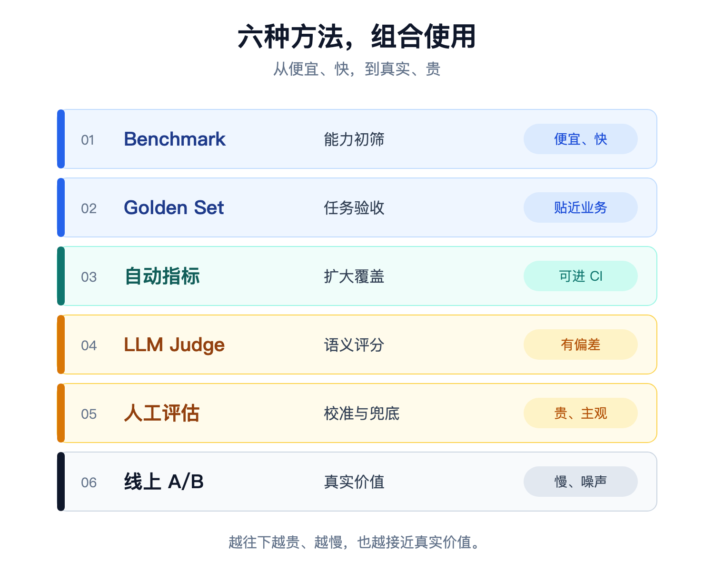
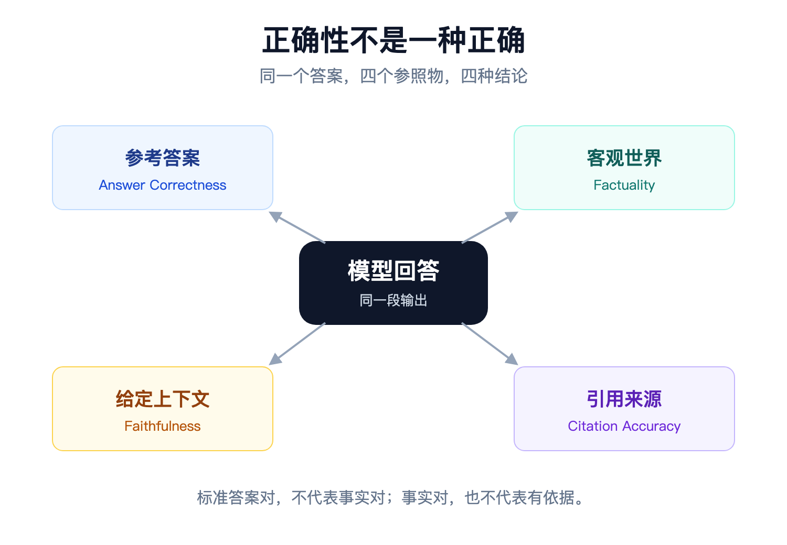

# 大模型评估（二）：六种方法，别只盯着 Benchmark

> Benchmark、Golden Set、人工、自动指标、LLM Judge 与线上 A/B

上一篇讲了为什么必须评估、评估分几层、难在哪里。

这一篇讲方法。

没有一种方法能同时做到便宜、快、准、贴近业务。工程上的正确做法是组合使用，而不是押注单一手段。

## 01 | 六种方法总览

| 方法 | 优势 | 局限 |
| --- | --- | --- |
| Benchmark | 标准、可横向比较 | 污染、与业务脱节 |
| Golden Set | 贴近真实、可回归 | 构建维护成本高 |
| 人工评估 | 能判断语义与业务 | 贵、慢、主观 |
| 自动指标 | 快、可重复、进 CI | 对开放式生成不敏感 |
| LLM Judge | 可批量评语义 | 有偏差、有成本 |
| 线上 A/B | 真实用户与结果 | 周期长、噪声大 |

一个常见的组合是：

> Benchmark 初筛 → Golden Set 验收 → 自动指标扩覆盖 → Judge 提效率 → 人工做校准 → 线上 A/B 定价值



*图 3：六种方法按成本和真实性组合使用。*

## 02 | Benchmark：能力体检，不是业务验收

Benchmark 是标准化任务、固定数据和固定评分脚本的集合。

它的价值是“大家用同一把尺子”，适合模型初筛和能力摸底。

| 类型 | 代表基准 | 看什么 |
| --- | --- | --- |
| 通识知识 | MMLU、C-Eval | 知识广度、中文能力 |
| 数学推理 | GSM8K、MATH | 多步算术与符号推理 |
| 代码能力 | HumanEval、MBPP | 短函数生成 |
| 工程代码 | SWE-bench | 真实仓库修复 |
| 事实性 | TruthfulQA | 抵抗错误前提 |
| 常识推理 | HellaSwag、BBH | 常识与多步逻辑 |
| 长上下文 | LongBench、RULER | 长文检索与抗干扰 |

**优点很明确：**

- 标准化，结果可复现。
- 适合横向比较。
- 能快速发现能力短板。
- 社区持续更新。

**局限也很明确：**

- **数据污染**：题目可能进了训练语料。
- **与业务不一致**：输入分布和评价标准都不同。
- **只评模型，不评系统**：不覆盖 Prompt、检索、工具和成本。
- **榜单过拟合**：模型可能针对基准优化。

工程建议是：**Benchmark 只做初筛，最终选型看企业 Golden Set。**

对疑似污染，可以做换问法、加干扰项、改写题测试。代码类任务优先看带时间切分、持续更新的基准。

## 03 | Golden Set：企业自己的“录用考试”

Golden Set 是从真实业务分布中抽样、经过专家标注、带标准答案和评分规则的测试集。

它像后端的回归测试集，但评价的是语义质量。

构建步骤可以概括成六步：

1. 定义任务与成功标准。
2. 从真实问题、工单、日志中采样。
3. 按任务、难度、业务域、风险分层。
4. 由懂业务的人写答案和评分要点。
5. 先试标 30–50 条，开校准会。
6. 版本化、冻结、记录变更。

样本不能只有“常见好问题”：

| 样本类型 | 作用 | 设计要点 |
| --- | --- | --- |
| 高频问题 | 代表主要流量 | 按线上频次加权 |
| 长尾问题 | 发现覆盖盲区 | 从低频日志补充 |
| 边界问题 | 测试模糊地带 | 多意图、歧义、缺上下文 |
| 应拒答 | 测试克制能力 | 无答案、越权、违规 |
| 对抗问题 | 测试安全边界 | 注入、角色扮演、诱导 |
| 回归样本 | 锁定已修复问题 | 每个事故至少一条 |

早期 100–300 条就能支撑方向判断。成熟期建议 500–2000 条，并按切片管理。

每个关键切片至少 30–50 条，否则置信区间会非常宽。

字段不用一次到位，但四类信息必须有：

- **问题与上下文**：真实问法、多轮历史。
- **标准答案**：参考答案、可接受答案、证据片段。
- **评分规则**：must_include、must_not_include、是否应拒答。
- **元数据**：任务类型、难度、业务域、风险等级。

问题设计也有讲究：保留真实口语和省略，但不要把答案写进问题；多意图问题不要为了标注方便强行拆开。

## 04 | 人工评估：贵，但不可替代

人工评估适合开放式写作、摘要质量、对话体验、专业正确性、品牌语气和安全边界。

它也是校准 LLM Judge 的唯一可靠基准。

评分表不能只写“1–5 分，5 分最好”，每一档都要有可观察的锚点。

| 分数 | 正确性 | 完整性 |
| --- | --- | --- |
| 5 | 完全正确，无事实错误 | 覆盖全部关键点 |
| 4 | 主体正确，小瑕疵 | 覆盖主要要点 |
| 3 | 部分正确，有影响判断的错 | 覆盖约一半 |
| 2 | 关键结论错误 | 只覆盖少量 |
| 1 | 完全错误或答非所问 | 未覆盖关键点 |

降低主观性，可以做几件事：

- 维度正交，正确性和完整性分开评。
- 提供正反例。
- 要求评审写出扣分理由。
- 隐藏模型名称和来源。
- 随机打乱答案顺序。
- 固定评审组，定期开校准会。

至少对 10%–20% 的样本做双人独立标注，计算一致率或 Cohen's kappa。

kappa 低于约定阈值时，先修 Rubric，不要继续堆标注量。

抽样建议：高风险全查，高频按比例抽，长尾按域抽，失败样本优先抽。

专家和普通用户不能互相替代：**专家评“对不对”，用户评“好不好用”。**

## 05 | 自动指标：便宜，但要知道它测什么

自动指标适合答案相对明确、标准可形式化的任务。

| 指标 | 适合 | 局限 |
| --- | --- | --- |
| Exact Match | 分类、抽取、短答案 | 同义表达判错 |
| Token F1 | 抽取、短答案 | 不懂语义和否定 |
| BLEU | 翻译、受约束生成 | 与人工相关性有限 |
| ROUGE | 摘要、复述 | 不判断事实一致性 |
| BERTScore | 摘要、改写 | 对事实错误不敏感 |
| 语义相似度 | 匹配、去重、检索 | 反义句可能高分 |
| 准确率 | 意图、路由、审核 | 类别不平衡时误导 |
| 召回率 | 检索、风险识别 | 单独看忽略误报 |
| Pass@k | 代码生成 | 需要测试用例 |

几个常用公式：

```text
F1 = 2 * P * R / (P + R)

BLEU ~ BP * exp(sum w_n * log p_n)

Pass@k = 1 - C(n-c, k) / C(n, k)
```

这些指标的共同假设是：参考答案唯一，或者表面相似等于语义正确。

对开放式生成，这个假设经常不成立。

合理用法是：结构化任务用 EM、F1、准确率；受约束生成用 BLEU、ROUGE 辅助；语义任务用 BERTScore 粗筛；最终质量由 Judge 和人工确认。

## 06 | LLM-as-a-Judge：效率工具，不是最终裁决

用一个能力较强的模型当裁判，按评分标准打分或做两两比较。

它把语义判断变成了可批量执行的 API 调用，是目前开放式评估最实用的折中。

| 模式 | 优点 | 缺点 |
| --- | --- | --- |
| Pointwise | 可解释、易聚合 | 分数尺度会漂移 |
| Pairwise | 更稳定、贴近偏好 | 只能排序，有位置偏差 |

Judge Prompt 的设计要点：

1. 角色和任务明确。
2. 维度正交，不要合成一个模糊总分。
3. 每档有可观察锚点。
4. 事实判断必须引用证据。
5. 强制输出 JSON。
6. 明确反偏差指令。
7. 写清什么情况直接判不通过。

常见偏差不能忽视：

| 偏差 | 表现 | 缓解 |
| --- | --- | --- |
| 位置偏差 | 偏好第一个答案 | 交换顺序各评一次 |
| 长度偏差 | 越长分越高 | 明确长度不加分 |
| 自我偏好 | 偏好同系列模型 | 多裁判、隐藏身份 |
| 格式偏差 | 偏好 Markdown | 统一格式后再评 |
| 谄媚偏差 | 被流畅表达骗 | 逐条核验证据 |
| 分数漂移 | 跨批次不可比 | 固定版本、锚点校准 |

Judge 的局限也要说清楚：

- 它也可能幻觉。
- 它偏好长答案和漂亮格式。
- 它成本不低，多裁判更贵。
- 它的分数会随版本变化。

所以 Judge 适合做初筛和扩覆盖，高风险场景必须保留人工抽检。

## 07 | 线上 A/B：最后的裁判

离线评估再真实，也只是对线上分布的一次采样。

它覆盖不了真实提问方式、多轮交互、延迟对行为的影响，以及“答案对了但用户不用”的体验问题。

线上实验的基本步骤：

1. 明确假设。
2. 定义主指标和护栏指标。
3. 按用户或会话稳定分流。
4. 一次只改一个主要因素。
5. 计算样本量和实验周期。
6. 做分切片分析。

| 类型 | 指标 | 作用 |
| --- | --- | --- |
| 主指标 | 任务完成率、解决率 | 判断是否成功 |
| 体验 | 点赞、点踩、追问 | 反映用户感受 |
| 行为 | 点击、采纳、留存 | 反映是否真在用 |
| 效率 | 人工接管率、处理时长 | 反映是否省事 |
| 性能 | P95 延迟、超时率 | 防止体验退化 |
| 成本 | 单次请求、工具成本 | 判断能否规模化 |
| 护栏 | 投诉、安全、隐私 | 防止副作用 |

风险控制靠三件事：

- **灰度**：先 1%–5% 流量。
- **小流量实验**：新模型先限制在低风险业务域。
- **回滚**：预设阈值、责任人和回滚方式。

低频高危事件不能依赖 A/B 的统计功效，必须用红队集和人工审计兜底。

## 08 | 七类指标怎么选

### 正确性：先分清参照物

| 指标 | 参照物 | 回答什么 |
| --- | --- | --- |
| Answer Correctness | 参考答案 | 和标准答案比，对不对 |
| Factuality | 客观世界 | 和真实世界比，对不对 |
| Faithfulness | 给定上下文 | 有没有资料依据 |
| Hallucination Rate | 无依据陈述 | 有多少内容是编的 |
| Citation Accuracy | 引用来源 | 引用是否支撑结论 |

举个例子：制度写“年假 10 天”，模型答“15 天，依据员工手册第 3 章”。

- Correctness：错。
- Factuality：与公司事实不符。
- Faithfulness：上下文不支持。
- Citation：引用存在，但不支撑。



*图 4：同一段回答，四个参照物会给出不同结论。*

RAG 场景如果只能选一个主指标，优先 Faithfulness。

### 相关性、完整性、指令遵循

| 指标 | 看什么 | 注意 |
| --- | --- | --- |
| Answer Relevance | 是否切题 | 切题不等于正确 |
| Context Relevance | 检索内容是否相关 | 相关不等于有答案 |
| Coverage | 必须要点覆盖 | 清单要专家维护 |
| Missing Key Points | 漏了哪些关键点 | 最适合做失败诊断 |
| Format Compliance | 格式是否合规 | 能解析不等于字段对 |
| Schema Valid Rate | JSON 是否合法 | 要测边界输入 |
| Length Control | 是否在长度区间 | 明确按字符还是 token |

### 安全、效率、稳定性

| 指标 | 看什么 | 注意 |
| --- | --- | --- |
| Jailbreak ASR | 越狱攻击成功率 | 攻击集要持续更新 |
| Privacy Leakage | 隐私泄露率 | 测直接问和诱导问 |
| False Refusal | 正常请求被误拒 | 必须和拒答率成对看 |
| P95 Latency | 长尾延迟 | 平均值会掩盖问题 |
| Cost per Success | 每个成功任务成本 | 比单次请求成本真实 |
| Cache Hit Rate | 缓存复用 | 语义缓存可能错复用 |
| Run Consistency | 多次运行一致率 | 关键结论要稳定 |
| Prompt Stability | 改写 Prompt 后表现 | 暴露脆弱设计 |

指标使用有五条原则：

1. 分层报告，不要只报总分。
2. 硬指标和软指标分开。
3. 给出样本量和不确定性。
4. 指标要能归因。
5. 指标随业务阶段演进。

## 09 | 第二篇小结

方法没有优劣，只有适用场景：

- Benchmark 做初筛。
- Golden Set 做验收。
- 自动指标扩覆盖。
- Judge 提效率。
- 人工做校准。
- 线上 A/B 定价值。

下一篇进入两个最典型的落地场景：RAG 和 Agent。

它们不能只看端到端结果，必须拆开评、看 Trace、做归因。

*下一篇：RAG 与 Agent，必须拆开评。*
