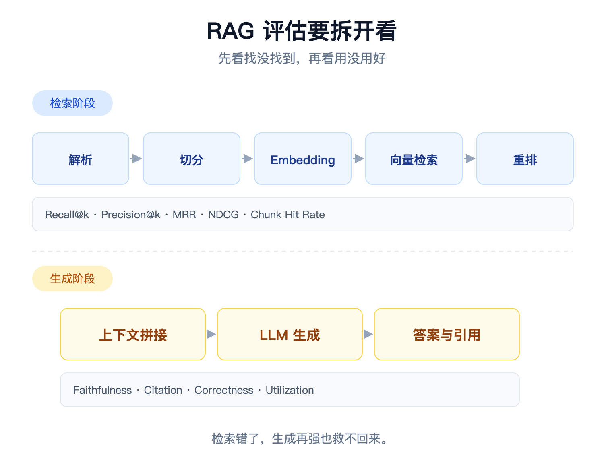
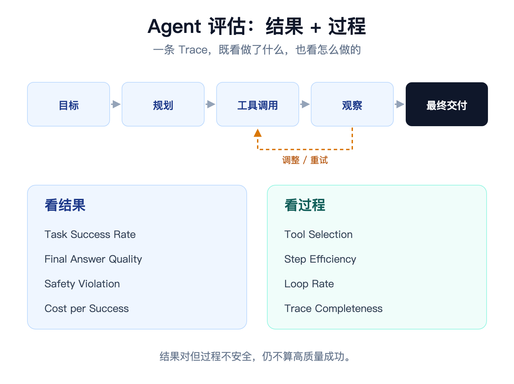

# 大模型评估（三）：RAG 与 Agent，必须拆开评

> 从检索、生成到 Trace，定位到底哪一环坏了

RAG 和 Agent 是企业落地中最典型的两种形态，也是最容易被“一个端到端准确率”掩盖问题的场景。

答案错了，可能是检索没找到、排序太靠后、上下文被忽略，也可能是模型没按资料回答。

不拆链路，优化就只能靠猜。

## 01 | RAG 为什么不能只看端到端

一条典型的 RAG 链路有七个环节：

```text
解析 → 切分 → Embedding → 检索
→ 重排 → 拼接 → 生成
```

每个环节都会失败，而且会往下游传播：

| 环节 | 典型失败 | 后果 |
| --- | --- | --- |
| 解析 | 表格错行、OCR 错误 | 检索到也是错的 |
| 切分 | 切断定义、块过大 | 片段缺少关键上下文 |
| Embedding | 领域词表示差 | 相近文档召不回 |
| 检索 | Top-K 太小、索引过期 | 正确文档不在候选集 |
| 重排 | 正确文档被排后 | 上下文里没有有用内容 |
| 拼接 | 超长截断、顺序乱 | 关键信息被淹没 |
| 生成 | 忽略上下文、引用错 | 答案不忠实 |

拆分的价值是归因。

如果 Faithfulness 从 0.92 掉到 0.84，而 Recall@5 没变，问题大概率在生成或 Prompt。

如果 Recall@5 也掉了，优先查索引、Embedding 和过滤条件。



*图 5：RAG 拆成检索与生成两段，分别评估。*

## 02 | 检索阶段：先保证找得到

检索评估需要带“相关文档或证据片段”标注的测试集。

| 指标 | 怎么算 | 注意 |
| --- | --- | --- |
| Recall@k | 命中相关数 / 全部相关数 | 多文档问题必看 |
| Precision@k | 前 k 个中相关数 / k | k 越大越易稀释 |
| MRR | 第一个相关结果的排名倒数 | 只看第一个相关结果 |
| NDCG@k | DCG / IDCG | 需要分级相关性标签 |
| Context Relevance | 召回内容与问题的相关度 | 相关不等于有答案 |
| Chunk Hit Rate | 答案 chunk 是否进前 k | 比文档级 Recall 严格 |
| Source Coverage | 应引用来源覆盖比例 | 适合多文档、多跳 |

几个公式：

```text
MRR = mean(1 / rank_first_relevant)

DCG@k = sum(rel_i / log2(i+1))

NDCG@k = DCG@k / IDCG@k
```

指标怎么选：

- 单跳问答：Recall@k + MRR + Chunk Hit Rate。
- 多文档综述：Recall@k + Source Coverage + NDCG。
- 有重排：召回看 Recall@50，重排后看 NDCG@5。

一个常见陷阱：只标了文档 ID，却用 Chunk Hit Rate 评估。

文档相关，不代表切出来的 chunk 包含答案。要标到 chunk 或证据片段，否则指标会虚高。

## 03 | 生成阶段：再看有没有用好

| 指标 | 衡量什么 | 注意 |
| --- | --- | --- |
| Answer Correctness | 最终答案是否正确 | 允许多种等价表达 |
| Faithfulness | 是否由上下文支持 | RAG 的核心指标 |
| Citation Accuracy | 引用是否支撑结论 | 存在不等于支撑 |
| Context Utilization | 有用证据是否被使用 | 区分没找到和没用上 |
| Refusal Accuracy | 该拒就拒、该答就答 | 两类错误要分开看 |

拒答能力建议用 2×2 矩阵：

| 系统行为 | 应回答 | 应拒答 |
| --- | --- | --- |
| 回答 | 正确回答 TP | 错误硬答 FP |
| 拒答 | 错误拒答 FN | 正确拒答 TN |

三个口径：

- 拒答召回率 = TN / (TN + FP)。
- 误拒率 = FN / (FN + TP)。
- 综合准确率 = (TP + TN) / 全部。

只报综合准确率不够。高风险场景里，FP 的代价远高于 FN。

“应拒答却硬答”应该单列为高危错误，单独设门槛。

## 04 | RAG 故障诊断

| 现象 | 先查什么 | 处理方向 |
| --- | --- | --- |
| 检索不到 | 文档是否在索引、Recall | 修解析、切分、索引 |
| 排序靠后 | MRR、NDCG、实际排名 | 加重排、混合检索 |
| 上下文被忽略 | 位置扰动测试 | 压缩上下文、关键证据前置 |
| 不忠实 | Faithfulness、无依据 claim | 强化引用、换模型 |
| 引用不准 | 引用与结论是否对应 | 用 chunk id、后置校验 |
| 知识过期 | 文档更新与索引同步 | 建更新流水线、标生效日期 |
| 多跳只答一半 | Source Coverage | 查询分解、多轮检索 |
| 正确但无引用 | 无引用答案比例 | 强制引用字段 |

诊断顺序建议：

> 文档在不在索引 → 排名够不够前 → 上下文有没有证据 → 生成是否忠实

不要一上来就换模型。多数 RAG 问题在数据和检索，不在生成模型。

## 05 | RAG 评估集怎么设计

RAG 评估集比普通 QA 多两类信息：证据位置和拒答预期。

| 字段 | 作用 | 示例 |
| --- | --- | --- |
| question | 真实问法 | 试用期年假怎么算 |
| expected_answer | 标准答案要点 | 按在职月份折算 |
| acceptable_answers | 允许的等价表达 | 按入职月数比例算 |
| reference_docs | 应引用文档 | HR-POLICY-2026 |
| evidence_spans | 支撑答案的原文 | 每满一个月折算 1/12 |
| must_include | 必须出现 | 按月份折算 |
| must_not_include | 绝不能出现 | 试用期没有年假 |
| reject_expected | 是否应拒答 | true / false |
| difficulty | 难度 | easy / hard |
| business_tag | 业务标签 | 入职咨询 |

样本设计要覆盖：

- 正样本：有明确答案。
- 负样本：知识库没有，应拒答。
- 干扰样本：有相似但不适用的条款。
- 时效样本：同一政策的新旧版本。
- 多跳样本：需要综合多份文档。
- 对抗样本：文档里藏恶意指令。

只构造“能答出来的问题”，会系统性高估系统能力。

## 06 | Agent 与普通 LLM 的区别

普通 LLM 评估一个输入到输出的映射。

Agent 评估一条轨迹：

```text
目标 → 规划 → 选工具 → 生成参数
→ 执行 → 观察 → 调整 → 终止
```

每一环都可能出错：

| 环节 | 评估问题 | 失败后果 |
| --- | --- | --- |
| 规划 | 计划是否覆盖目标 | 方向错，后面全错 |
| 选工具 | 是否选对工具 | 白跑、查错数据 |
| 参数 | 是否合法、完整 | 报错、空结果、误操作 |
| 多步执行 | 状态和依赖是否正确 | 用过期结果、顺序错 |
| 错误恢复 | 失败后能否改路线 | 卡死、死循环 |
| 终止 | 是否知道何时停 | 过度执行、提前结束 |
| 交付 | 是否完整、可审计 | 用户无法使用 |

关键原则：**Agent 的成功必须由外部状态验证，不能由模型自己说“我完成了”。**

“已创建工单”要以工单 ID 为准，“已发邮件”要以回执为准。

## 07 | Agent 十项指标

| 指标 | 衡量什么 | 注意 |
| --- | --- | --- |
| Task Success Rate | 任务是否真正完成 | 用外部状态判定 |
| Plan Quality | 计划是否合理完整 | 合理不等于成功 |
| Tool Selection Accuracy | 工具是否选对 | 需要期望序列或 Judge |
| Tool Call Success Rate | 调用是否成功 | 参数、接口、解析都算 |
| Step Efficiency | 步数是否合理 | 别为省步数牺牲正确 |
| Error Recovery Rate | 出错后是否恢复 | 要定义什么叫恢复 |
| Loop Rate | 是否无效循环 | 按重复动作检测 |
| Safety Violation Rate | 是否越权违规 | 高危应零容忍 |
| Trace Completeness | 轨迹是否可审计 | 必填字段完整率 |
| Final Answer Quality | 最终交付质量 | 过程不安全仍不通过 |

再补四个成本类指标：

- Cost per Success：总成本 / 成功任务数。
- Time to Completion：到可验收结果的时间。
- Human Intervention Rate：需要人工接管的比例。
- Recovery Latency：从错误到恢复的步数。

## 08 | Trace 评估：看过程，不只看答案

一个最小 Trace 长这样：

```json
{
  "step": 1,
  "tool": "order.query",
  "args": {"order_id": "A10086"},
  "observation": {"status": "paid"},
  "latency_ms": 320,
  "error": null
}
```



*图 6：Agent 既看最终结果，也看执行过程。*

基于 Trace 可以检查：

| 维度 | 检查什么 | 方法 |
| --- | --- | --- |
| 步骤合理性 | 每步是否服务目标 | 人工或 Judge |
| 工具必要性 | 是否有冗余调用 | 对照参考路径 |
| 参数正确性 | 是否合法、语义正确 | 规则 + 业务比对 |
| 观察利用 | 结果是否被正确使用 | 看后续步骤引用 |
| 循环 | 是否重复相同动作 | 规则 + 相似度 |
| 关键步骤 | 是否跳过校验、确认 | 流程检查清单 |
| 安全边界 | 是否越权、碰敏感数据 | 权限日志 + 红队 |

评估方法组合：

1. 规则检查：Schema、白名单、必填步骤、循环次数。
2. Judge 评估：步骤合理性、观察利用、计划质量。
3. 人工复盘：抽样看完整 Trace，重点看失败和高风险。
4. 结果验证：用外部状态或验收脚本判断是否完成。

**可审计的成功，比偶然的成功更有价值。**

最终答案对，但过程跳过校验、用了过期数据、调了越权工具，这次执行不应算高质量成功。

## 09 | Agent 评估难点

| 难点 | 表现 | 缓解 |
| --- | --- | --- |
| 路径不唯一 | 正确路径被判错 | 评目标达成，不强制路径 |
| 中间对最终错 | 每步合理但结果不完整 | 过程 + 结果一起看 |
| 结果对过程险 | 答案对但越权 | 安全指标一票否决 |
| 环境不可复现 | 昨天成功今天失败 | 固定环境快照、Mock |
| 多 Agent 难归因 | 整体失败不知谁的错 | 记录跨 Agent 消息 |
| 成功标准模糊 | “写方案”算不算完成 | 预先定义验收清单 |

还有一个常见问题：成本与步数膨胀。

Agent 倾向多调用、多验证，成功率略升，成本可能翻几倍。

所以要用 Cost per Success 和 Step Efficiency 约束，并设预算上限。

## 10 | 企业评估集：从哪来、怎么分层

数据来源优先级：真实数据 > 专家整理 > 合成数据。

| 来源 | 价值 | 注意 |
| --- | --- | --- |
| 用户问题 | 最接近真实分布 | 脱敏、去噪 |
| 客服工单 | 有真实失败场景 | 需提炼标准结论 |
| 搜索日志 | 真实表达和需求 | 缺上下文和答案 |
| 产品文档 | 权威知识、可标证据 | 可能过期、版本多 |
| 专家出题 | 覆盖高风险边界 | 可能偏离真实问法 |
| 线上失败 | 最有价值的回归样本 | 脱敏、根因分析 |
| 安全红队 | 覆盖越狱、注入、隐私 | 需专门设计 |
| 业务边界 | 测试澄清、拒答、转人工 | 标准需产品参与 |

样本要显式覆盖：

- 高频问题、低频高风险、长尾问题。
- 模糊问题、多意图、上下文依赖。
- 应拒答、对抗性、回归样本。

数据集要分层管理：

| 数据集 | 用途 | 是否门禁 |
| --- | --- | --- |
| 开发集 | 日常调试 | 否 |
| 回归集 | 防退化 | 软门禁 |
| 门禁集 | 发布验收 | 硬门禁 |
| 安全集 | 越狱、注入、隐私 | 一票否决 |
| 长尾集 | 低频边界 | 视业务 |
| 线上抽样 | 监测分布漂移 | 否 |

维护动作：

- 每月补新业务、新政策、新失败。
- 入库前去重，精确 + 近邻。
- 数据集打版本，报告记录版本。
- 与训练集、Few-shot 做污染检测。
- 线上 bad case 脱敏后回流。
- 每季度专家复审、校准 Rubric。

没有回流的评估集，半年后就会变成历史资料，而不是质量防线。

## 11 | 第三篇小结

RAG 和 Agent 的评估，核心都是四个字：**拆开、归因。**

- RAG 拆检索和生成，先看找没找到，再看用没用好。
- Agent 拆过程和结果，既看任务是否完成，也看过程是否安全可审计。
- 评估集要覆盖负样本、边界样本和高风险样本。

下一篇讲工程化：平台怎么搭、伪代码怎么写、Judge 模板怎么设计、报告怎么写、门禁怎么接。

*下一篇：把评估接进研发流程。*

---

## 参考文献

以下文献是本文方法与观点的主要来源，也可作为延伸阅读；未在正文中逐条标注引用。为便于公众号阅读，仅保留作者、标题、发表信息与 arXiv 编号，未附外链。

1. Lewis, P., Perez, E., Piktus, A., et al. Retrieval-Augmented Generation for Knowledge-Intensive NLP Tasks. NeurIPS 2020. arXiv:2005.11401.
2. Es, S., James, J., Espinosa-Anke, L., & Schockaert, S. RAGAS: Automated Evaluation of Retrieval Augmented Generation. EACL 2024 Demo. arXiv:2309.15217.
3. Saad-Falcon, J., Khattab, O., & Potts, C. ARES: An Automated Evaluation Framework for Retrieval-Augmented Generation Systems. NAACL 2024. arXiv:2311.09476.
4. Liu, N. F., Lin, K., Hewitt, J., et al. Lost in the Middle: How Language Models Use Long Contexts. TACL 2024. arXiv:2307.03172.
5. Gao, L., Ma, X., Lin, J., & Callan, J. Precise Zero-Shot Dense Retrieval without Relevance Labels. ACL 2023. arXiv:2212.10496.
6. Asai, A., Wu, Z., Wang, Y., et al. Self-RAG: Learning to Retrieve, Generate, and Critique through Self-Reflection. ICLR 2024. arXiv:2310.11511.
7. Yan, S.-Q., Gu, J.-C., Zhu, Y., & Ling, Z.-H. Corrective Retrieval Augmented Generation. arXiv:2401.15884, 2024.
8. Yao, S., Zhao, J., Yu, D., et al. ReAct: Synergizing Reasoning and Acting in Language Models. ICLR 2023. arXiv:2210.03629.
9. Shinn, N., Cassano, F., Berman, E., et al. Reflexion: Language Agents with Verbal Reinforcement Learning. NeurIPS 2023. arXiv:2303.11366.
10. Liu, X., Yu, H., Zhang, H., et al. AgentBench: Evaluating LLMs as Agents. ICLR 2024. arXiv:2308.03688.
11. Zhou, S., Xu, F. F., Zhu, H., et al. WebArena: A Realistic Web Environment for Building Autonomous Agents. ICLR 2024. arXiv:2307.13854.
12. Jimenez, C. E., Yang, J., Wettig, A., et al. SWE-bench: Can Language Models Resolve Real-World GitHub Issues? ICLR 2024. arXiv:2310.06770.
13. Yao, S., Shinn, N., Razavi, P., & Narasimhan, K. τ-bench: A Benchmark for Tool-Agent-User Interaction in Real-World Domains. arXiv:2406.12045, 2024.
