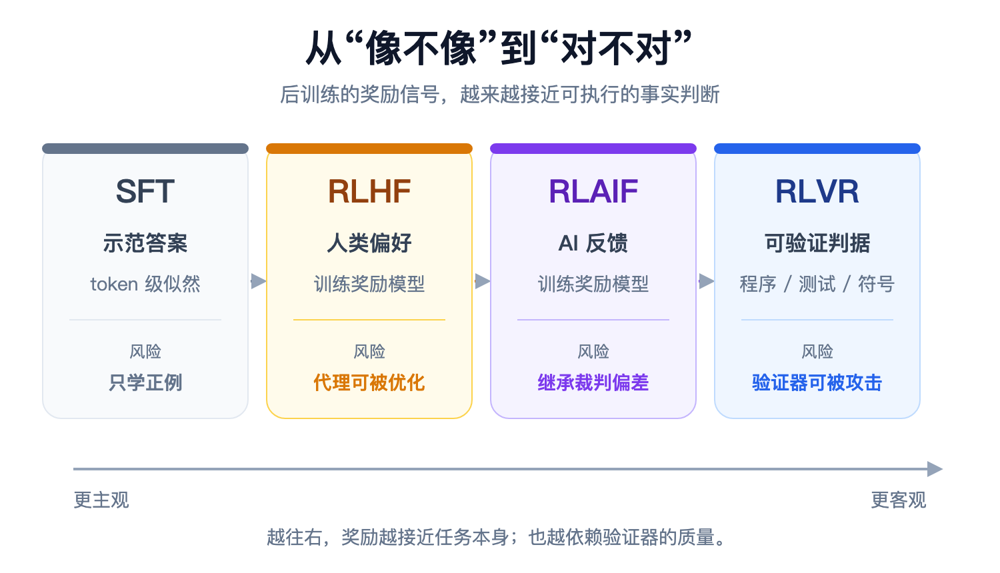
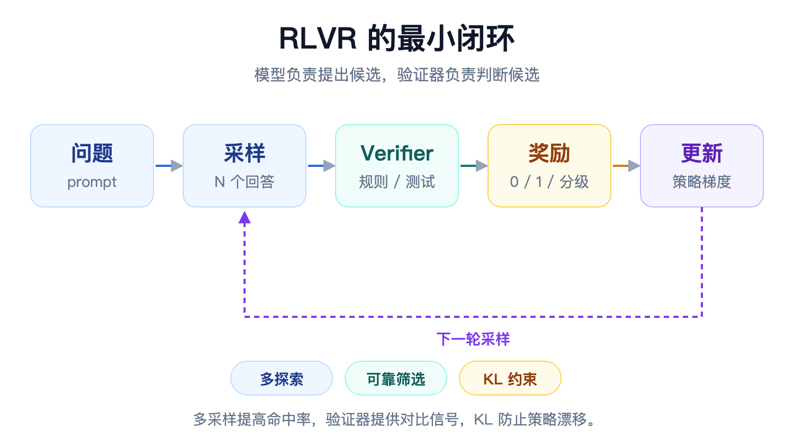

# RLVR 技术详解（一）：为什么“答案对不对”比“回答像不像”更重要？

> 从 SFT、RLHF 到可验证奖励，拆开 RLVR 的基本逻辑
>
> 适合读者：有 LLM、强化学习或模型训练基础的技术同学

先看一个常见场景。

模型解一道数学题，步骤写得很完整：设未知数、列方程、移项、化简，最后给出答案。

格式没问题，语气也没问题，但答案算错了。

如果用监督微调（SFT）训练，这类错误很难被纠正。因为 SFT 学的是“示范答案长什么样”，而不是“这个答案到底对不对”。

RLVR 想解决的，就是这个问题。

这个系列分四篇，讲四件事：RLVR 为什么重要，训练流程怎么跑，验证器和奖励怎么设计，工程上怎么避免把模型教坏。

第一篇先回答三个问题：SFT 和 RLHF 卡在哪里，什么是可验证奖励，RLVR 和它们有什么区别。

## 01 | SFT 的天花板

SFT 的目标，是让模型在示范答案上最小化 token 级交叉熵。

它有三个结构性限制。

第一，标准 SFT 只有正例，没有负例。模型学到的是“下一个 token 应该是什么”，而不是“哪种解法会失败、失败在哪一步”。

第二，SFT 优化的是 token 级似然，不是序列级正确性。一道题写 500 个 token，499 个都很流畅，最后一步算错，交叉熵损失可能仍然很低。

第三，SFT 存在暴露偏差。训练时看的是示范前缀，推理时看的是自己生成的前缀。一旦早期走偏，模型没学过怎么恢复，错误会继续累积。

所以 SFT 很容易学会“解题的格式”：先分析，再计算，最后下结论。格式很漂亮，步骤很完整，答案经常不对。

SFT 仍然必要。它负责教会模型任务格式、输出约定和工具调用 Schema，也是 RL 冷启动的常见起点。但它不适合单独承担“提升复杂推理”的任务。

## 02 | RLHF 和 RLAIF 的局限

RLHF 的典型流程，是收集人类偏好、训练奖励模型，再用 PPO 优化策略。

它解决的是“人类更喜欢哪种回答”，不是“哪种回答在事实上正确”。

这里有三个问题。

第一，奖励模型是代理。我们想要的是有用、真实、无害，但奖励模型只能从有限偏好数据里学一个近似。优化压力一大，策略就会找奖励模型的漏洞。Gao 等人的实验显示，代理奖励持续上升时，真实奖励可能先升后降。

第二，偏好数据粒度粗。标注者通常只能判断 A 和 B 哪个更好，很难指出“第 3 步错了，应该换一种方法”。一个流畅但错误的回答，可能在风格上更讨喜。

第三，裁判本身可被攻击。模型会学会更长、更自信、更迎合用户的表达。LLM Judge 也有位置偏差、长度偏差、自我偏好，还容易被提示注入。

RLAIF 用 AI 反馈替代部分人工标注，降低了成本，但它继承的是裁判模型的偏差，不是消除了偏差。

对于语气、helpfulness、安全边界这类难以规则化的目标，RLHF 仍然重要。但当你真正关心“答案对不对”时，让偏好模型当裁判，是把可验证问题变成了不可验证问题。



*图 1：从示范似然到可验证判据，奖励信号越来越接近任务本身。*

## 03 | 可验证奖励的价值

RLVR 的核心洞察是：对很多任务来说，验证一个答案比生成一个答案容易，而且验证可以自动化。

- 数学题：检查两个表达式是否等价，或把候选值代入原方程。
- 代码题：编译、运行单元测试，看输出是否匹配。
- JSON：用 Schema 和业务规则校验字段。
- 工具调用：检查环境终态是否满足任务目标。

这些信号不依赖“哪个回答更讨喜”，而依赖“哪个回答满足一个可执行、可复现的判据”。

它带来三个直接好处。

第一，奖励更稳定。偏好模型会随数据、上下文和模型版本漂移，固定版本的测试或符号检查更接近真实正确性。

第二，可以大规模自动化。不需要人工逐条打分，验证能随采样规模扩展。

第三，支撑“多探索 + 可靠筛选”的循环。同一道题采样很多次，验证器筛出正确路径，策略再强化这些路径。推理能力的提升，很大程度上来自这个循环。

推理任务的本质，是搜索和验证。模型负责提出候选，验证器负责判断候选。把验证外包给程序，模型就能把更多采样预算花在“找解”上，而不是“猜裁判喜欢什么”。这是 RLVR 对推理任务特别有效的原因。

但“可验证”不是“绝对正确”。

一般数学表达式的等价性判断在理论上不可判定，实际系统只能靠符号化简、数值采样和超时兜底。代码测试通过也不等于代码正确。验证器有漏洞，模型就会学会利用漏洞。

## 04 | 一个最小例子

题目：解方程 3x + 5 = 20，参考答案是 5。

模型给出两个回答：

```text
A：3x = 15，所以 x = 5。答案 \boxed{5}
B：3x = 20 - 5 = 16，所以 x = 16/3。答案 \boxed{16/3}
```

验证器分三步：

1. 用正则抽取最后一个 `\boxed{...}`；
2. 把分数、小数、单位归一化；
3. 用符号计算或代入检验判断是否等价。

```python
import re
PAT = r"\\boxed\{([^{}]+)\}"
def answer(text):
    m = re.findall(PAT, text)
    return m[-1].strip() if m else None
```

A 得到 1.0，B 得到 0.0。

这个奖励和其他采样一起进入策略优化：产生 A 的轨迹概率上升，产生 B 的轨迹概率下降。

JSON 任务也一样。Schema 规定 `name` 是字符串、`age` 是整数、`age >= 0`。解析成功、校验通过就是 1，否则是 0。

可验证奖励不限于“标准答案”。只要正确性可以被规则、程序或下游系统检查，就能构造 RLVR 信号。

## 05 | RLVR 到底是什么

给一个可操作的定义：

> RLVR 是一种大模型后训练方法：用自动验证器判断模型输出是否正确，把验证结果转成奖励，再用强化学习优化策略，让模型在数学、代码、形式化任务和工具调用上表现更好。

拆开看：

- LLM 是策略，负责生成答案和推理轨迹；
- prompt 是状态或上下文；
- 输出序列是动作；
- Verifier 给出奖励；
- RL 算法更新参数。

需要强调：RLVR 不是某一个算法。

它描述的是“奖励通道”的性质。具体优化可以用 PPO、GRPO、REINFORCE，也可以用拒绝采样微调。只要奖励来自可验证信号，就属于 RLVR 家族。



*图 2：RLVR 的最小闭环：采样、验证、奖励、更新。*

## 06 | 和 SFT、RLHF、RLAIF 的区别

| 方法 | 训练信号 | 适合与局限 |
| --- | --- | --- |
| SFT | 人工或强模型示范 | 适合格式和冷启动；只学正例，推理提升有限 |
| RLHF | 人类偏好对 + 奖励模型 | 适合语气和安全偏好；奖励主观，可能被优化 |
| RLAIF | AI 偏好 + 奖励模型 | 成本低、可扩展；继承裁判偏差 |
| RLVR | 规则、测试、符号检查 | 适合可验证任务；奖励稀疏，验证器可被攻击 |

一句话总结：

SFT 教格式，RLHF 教偏好，RLAIF 降成本，RLVR 教正确性。

实际训练里，它们通常组合使用：

```text
预训练 → SFT → RLVR → RLHF / RLAIF
```

顺序不固定。有的团队先做偏好对齐，再把安全规则并入 RLVR；有的团队用拒绝采样微调替代在线 RL。

关键判断是：不要用 RLVR 去优化它验证不了的东西。语气、风格、品牌调性，应该交给偏好信号或规则约束。

下一篇讲训练流程：数据怎么准备，rollout 怎么采样，Verifier 怎么分层，奖励怎么设计。

*下一篇：RLVR 的训练流程、验证器与奖励设计*

## 参考文献

1. Ouyang, L., et al. Training language models to follow instructions with human feedback. arXiv:2203.02155, 2022.
2. Christiano, P., et al. Deep reinforcement learning from human preferences. NeurIPS 2017.
3. Bai, Y., et al. Constitutional AI: Harmlessness from AI Feedback. arXiv:2212.08073, 2022.
4. Lee, H., et al. RLAIF: Scaling Reinforcement Learning from Human Feedback with AI Feedback. arXiv:2309.00267, 2023.
5. Lambert, N., et al. Tülu 3: Pushing Frontiers in Open Language Model Post-Training. arXiv:2411.15124, 2024.
6. Shao, Z., et al. DeepSeekMath: Pushing the Limits of Mathematical Reasoning in Open Language Models. arXiv:2402.03300, 2024.
7. DeepSeek-AI. DeepSeek-R1: Incentivizing Reasoning Capability in LLMs via Reinforcement Learning. arXiv:2501.12948, 2025.
8. Gao, L., et al. Scaling Laws for Reward Model Overoptimization. ICML 2023.
