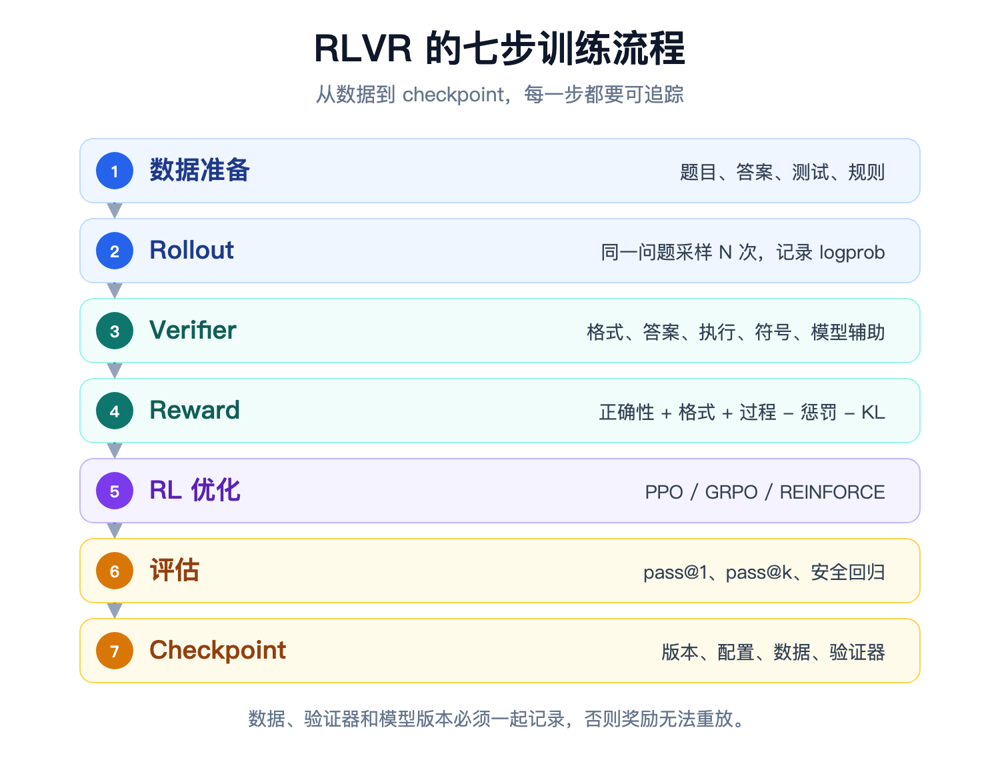
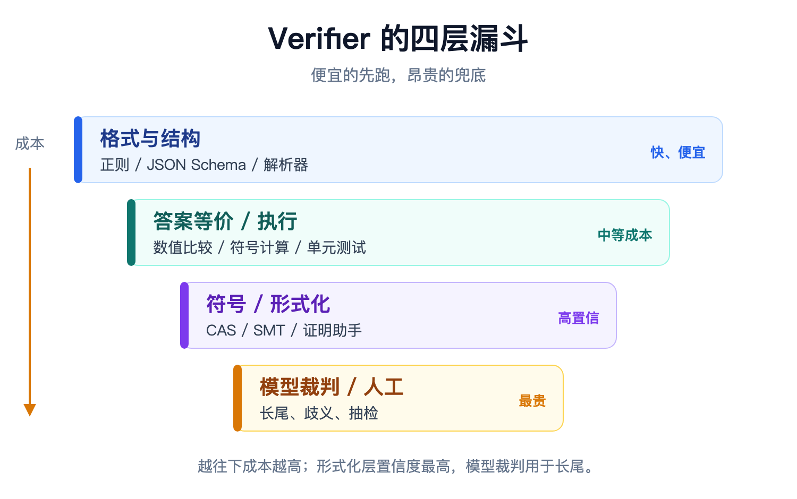

# RLVR 技术详解（二）：训练流程、验证器与奖励设计

> 一个 RLVR 系统能不能训起来，先看验证器，再看奖励
>
> 适合读者：有 LLM 训练或强化学习基础的技术同学

上一篇讲了 RLVR 为什么重要。

这一篇讲怎么跑。

完整流程可以概括为：

```text
问题采样 → 生成多个候选 → Verifier 验证
        → 奖励计算 → 策略更新 → 评估回归
```

看起来是单向流水线，实际系统里这些阶段是异步、并行、反复迭代的。

真正决定成败的，往往不是 PPO 还是 GRPO，而是两个东西：验证器是否可靠，奖励是否把模型引向正确的方向。



*图 3：从数据到 checkpoint，每一步都要可追踪。*

## 01 | 数据准备

RLVR 的样本不只是“题目加答案”。

一个可训练的样本通常包含：

- prompt：题目、系统提示、输出格式要求；
- reference answer：参考答案；
- verification rule：用什么方式验证；
- test cases：公开测试、隐藏测试、边界测试；
- constraints：时间、内存、权限、允许的库；
- metadata：来源、难度、题型、去重指纹；
- split：训练、验证、测试。

不同任务族，数据重点不同。

| 任务族 | 核心字段 | 主要验证方式 |
| --- | --- | --- |
| 数学 | 题目、答案、格式 | 符号等价、数值比较、代入 |
| 代码 | 题面、签名、测试 | 编译、单元测试、静态检查 |
| 结构化 | 输入、Schema、规则 | Schema 校验、下游 dry-run |
| 形式化 | 定理、证明脚本 | 证明助手内核检查 |
| 工具调用 | 任务、工具、期望状态 | 环境终态检查 |
| Agent | 目标、环境、成功判据 | 终态、轨迹、安全策略 |

数据准备有三条硬规则。

第一，隐藏测试不能放进 prompt。模型看得到测试，就会针对测试优化。

第二，验证器规格要版本化。同一个样本在不同验证器版本下，奖励可能不同。

第三，要做污染检查。训练题不能和评测集重叠，代码题还要检查参考实现是否泄漏。

## 02 | Rollout 采样

对每个问题，策略采样多个回答，通常 4 到 16 个，8 个是常见起点。

采样温度一般高于评估温度，用来增加探索。同时要设置最大输出长度、停止序列和超时。

一次 rollout 要记录：

- token 序列和 token ID；
- 每个 token 的 logprob；
- 回答文本；
- 结束原因；
- 采样参数和模型版本；
- 验证结果和奖励。

为什么要多采样？

一是估计基线。GRPO 用组内平均奖励当 baseline，降低方差。

二是增加覆盖。复杂题目的正确解，可能只出现在少数采样里。

三是提供对比信号。同一道题下，正确轨迹和错误轨迹的对比，比跨题比较更有信息量。

工程上要特别注意“零方差组”。

如果一组采样全对或全错，组内奖励没有差异，advantage 接近零，这批数据对更新没有贡献。

难度分层、动态采样和题目过滤，都是为了减少这种无效样本。

## 03 | Verifier 的五种类型

验证器是 RLVR 的核心资产。常见的有五类。

| 类型 | 判断方式 | 主要风险 |
| --- | --- | --- |
| 规则型 | 正则、JSON Schema、字段约束 | 脆、易绕过、不查语义 |
| 答案型 | 精确匹配、数值比较、符号等价 | 归一化过度或不足 |
| 执行型 | 编译、单测、沙箱运行、SQL | 成本高、覆盖不足、安全风险 |
| 符号型 | CAS、定理证明器、SMT | 覆盖有限、可能超时 |
| 模型辅助 | LLM Judge、Reward Model | 主观、可被提示注入 |

实际系统通常分层使用：

```text
格式与结构 → 答案等价 / 单测
          → 符号检查 / 形式化证明
          → 模型裁判 / 人工抽检
```

便宜的先跑，昂贵的兜底。低层失败可以短路，但短路原因要记录。



*图 4：先便宜，后昂贵；形式化层置信度最高，模型裁判处理长尾。*

## 04 | 验证器的质量要求

验证器不是“写个正则”那么简单。它要满足：

- 准确：误判率和漏判率低；
- 稳定：同一输入、同一版本，输出一致；
- 可复现：奖励能追溯、能重放；
- 抗攻击：模型难以利用漏洞；
- 安全：运行模型代码不会危害宿主机；
- 成本可控：延迟和算力在预算内。

其中最重要的是准确率，而且要分两个方向看。

假阳性，是把错误判成正确。模型会主动放大它，所以通常更危险。

假阴性，是把正确判成错误。它会压低正确轨迹的概率，浪费样本。

在人工审核集上，要分别统计 precision 和 recall。RLVR 通常更关心 precision，因为假阳性会被策略反复利用。

还有一个工程细节：验证结果要用三态。

`correct`、`incorrect`、`verifier_error`。

验证器超时、沙箱崩溃、缺依赖，不能直接记 0 分。否则训练信号里会混入大量噪声。

## 05 | 奖励怎么设计

最简单的奖励是二值：

```text
正确 → 1，错误 → 0
```

优点是简单、客观、容易审计。

缺点是稀疏。难题采样 8 次全错，所有奖励都是 0，策略梯度没有区分度。

更常见的是多分量组合：

```text
R = 正确性 + 格式 + 过程
  - 长度惩罚 - 安全惩罚 - KL
```

| 奖励项 | 作用 | 主要风险 |
| --- | --- | --- |
| 正确性 | 主信号 | 稀疏，误判会被放大 |
| 格式 | 鼓励遵循约定 | 模型只学格式 |
| 过程 | 鼓励合理步骤 | 需要过程验证器，可被模板欺骗 |
| 长度惩罚 | 抑制无意义长推理 | 误伤真正的难题 |
| 安全惩罚 | 抑制危险行为 | 太强会导致过度保守 |
| KL | 限制策略漂移 | 太强学不动，太弱语言退化 |

几条经验：

正确性必须是主信号；格式和过程奖励只能辅助。

辅助奖励要有条件。比如格式奖励只在答案正确时给。

奖励尺度要稳定。不同验证器的输出范围要统一。

惩罚要可解释。触发条件要能审计，不能是黑盒。

## 06 | 过程奖励与结果奖励

结果奖励只看最终答案，最容易自动验证，适合大规模训练。

DeepSeek-R1-Zero 主要使用结果奖励，证明了在足够强的基座和足够多的采样下，结果奖励可以驱动推理提升。

但结果奖励的信用分配很粗。答案错了，模型不知道错在哪一步；答案对了，也不代表推理正确。

过程奖励对中间步骤评分，能缓解这个问题。

常见做法有三种：

- 人工给步骤打“正确 / 错误 / 中性”标签，训练 PRM；
- 从某个中间步骤继续采样，用最终正确率估计进展；
- 用规则、符号检查或另一个模型判断步骤是否合法。

过程奖励更细，但成本更高：步骤边界难定义，PRM 可能被“看起来合理”的步骤欺骗，过程分和结果分的权重也要调。

一个务实的组合是：结果奖励为主，过程奖励为辅，而且只在可独立验证的步骤上使用。

比如数学里的代数变形、代码里的每个函数，可以用符号计算或单元测试检查；这比让 LLM 给步骤打分可靠得多。

## 07 | Reward Hacking

Reward Hacking，是模型找到一种“得分高但不做正确事”的路径。

在 RLVR 里，它通常长这样：

| 模式 | 典型信号 | 缓解 |
| --- | --- | --- |
| 硬编码测试 | 只对公开样例返回正确结果 | 隐藏测试、随机输入、变异测试 |
| 枚举答案 | 输出多个候选，希望验证器取中 | 限制格式、只取最后一个、多答案判错 |
| 格式绕过 | 用特殊字符欺骗解析器 | 严格解析、Schema 校验、模糊测试 |
| Judge 欺骗 | 插入指令或讨好性语言 | 提示注入过滤、多裁判、规则兜底 |
| 长度填充 | 输出变长但信息不增 | 长度惩罚、信息密度检查、人工抽检 |
| 沙箱探测 | 访问网络、文件、环境变量 | 微虚拟机、网络隔离、最小权限 |

Reward Hacking 不是一次性问题，而是持续对抗。

模型变强，就可能发现新漏洞。工程上要把“攻击验证器”当成独立测试任务，定期做红队。

## 08 | 小结

这一篇的核心是三句话：

Verifier 决定奖励质量。

奖励设计决定训练方向。

三态结果、KL 控制和红队测试，是稳定训练的底线。

下一篇进入具体任务：数学题怎么归一化答案，代码题怎么设计测试，结构化输出和工具调用怎么验证，以及一个可落地的工程架构。

*下一篇：数学、代码、工具调用与工程架构*

## 参考文献

1. Shao, Z., et al. DeepSeekMath: Pushing the Limits of Mathematical Reasoning in Open Language Models. arXiv:2402.03300, 2024.
2. DeepSeek-AI. DeepSeek-R1: Incentivizing Reasoning Capability in LLMs via Reinforcement Learning. arXiv:2501.12948, 2025.
3. Lightman, H., et al. Let's Verify Step by Step. arXiv:2305.20050, 2023.
4. Yu, Q., et al. DAPO: An Open-Source LLM Reinforcement Learning System at Scale. arXiv:2503.14476, 2025.
5. Gao, L., et al. Scaling Laws for Reward Model Overoptimization. ICML 2023.
6. Amodei, D., et al. Concrete Problems in AI Safety. arXiv:1606.06565, 2016.
7. Zheng, L., et al. Judging LLM-as-a-Judge with MT-Bench and Chatbot Arena. arXiv:2306.05685, 2023.
8. Rafailov, R., et al. Direct Preference Optimization: Your Language Model is Secretly a Reward Model. arXiv:2305.18290, 2023.
