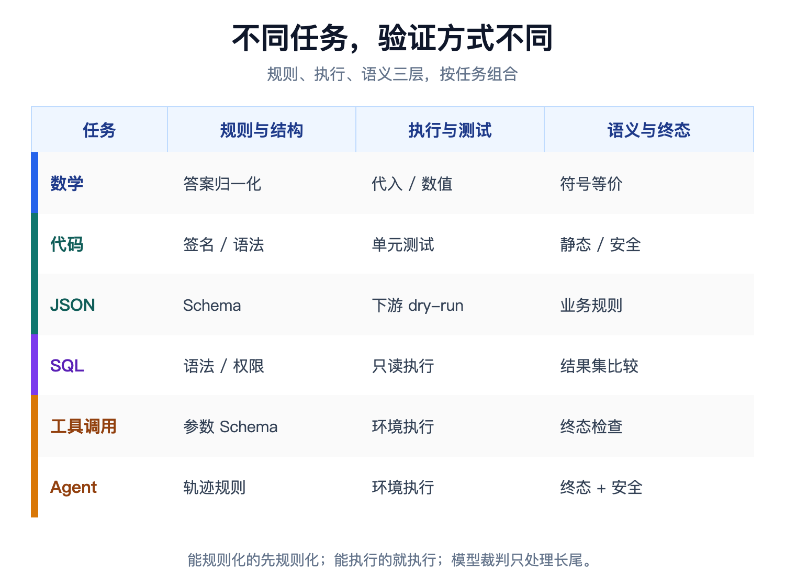
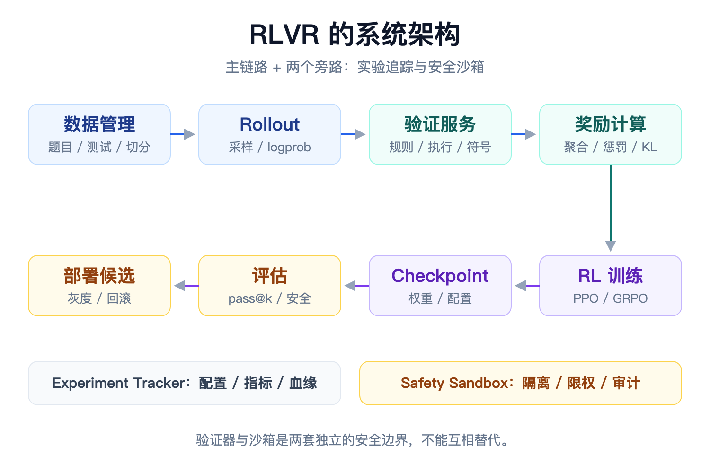

# RLVR 技术详解（三）：数学、代码、工具调用怎么构建奖励

> 从答案归一化、测试分层到沙箱和工程架构
>
> 适合读者：正在做数学推理、代码生成或 Agent 训练的技术同学

前两篇讲了原理和训练流程。

这一篇进入具体任务：数学题怎么判断答案等价，代码题怎么设计测试，JSON、SQL 和工具调用怎么验证，以及一个可落地的系统长什么样。

先说结论：不同任务的验证器差别很大，但设计思路是一致的。

能规则化的先规则化，能执行的就执行，能符号检查的就符号检查；模型裁判只处理长尾，不做主裁判。

## 01 | 数学：答案归一化是第一步

数学 RLVR 的数据通常包含题目、参考答案、题型、难度和答案格式。

格式差异是验证器最大的敌人。

同一个答案，可能写成：

```text
5、5.0、x=5、\boxed{5}、5 元
```

归一化要做这些事：

- 去掉空白、`$`、`\text{}` 等包装；
- 统一分数、小数和百分比；
- 统一根式和精确值；
- 统一单位和量纲；
- 比较集合而不是顺序；
- 保留区间的开闭；
- 处理“无解”“任意实数”等特殊答案。

但不要过度归一化。把单位、定义域、多解顺序全部抹平，会把错误答案判成正确。

等价性验证通常分三层：

1. 符号比较：用 SymPy 化简 `candidate - reference`；
2. 数值代入：在多个点代入，比较数值；
3. 结构比较：集合、区间、矩阵按结构比。

SymPy 不是万能的。化简可能很慢、失败，或因假设不同给出不同结果。工程上要设超时，准备数值兜底，对高风险样本人工审核。

| 常见问题 | 典型表现 | 缓解 |
| --- | --- | --- |
| 格式不统一 | 抽取失败或误判 | 统一协议、规则版本化 |
| 多解顺序不同 | 正确解被判错 | 集合比较、维护完整解集 |
| 答案对推理错 | 猜中或枚举 | 扰动测试、过程检查、抽检 |
| 题目有歧义 | 不同理解不同答案 | 数据清洗、明确约定 |
| 验证器超时 | 复杂表达式卡住 | 超时、数值兜底、缓存 |

## 02 | 代码：测试分层与沙箱

代码题样本要包含题面、函数签名、公开测试、隐藏测试、约束和难度。

验证一般分五层。

| 层级 | 检查内容 | 失败含义 |
| --- | --- | --- |
| 编译 | 语法、导入、签名 | 代码不可执行 |
| 公开测试 | 题面样例 | 基本功能错误 |
| 隐藏测试 | 边界、随机用例 | 泛化不足 |
| 静态安全 | 危险调用、权限 | 沙箱风险 |
| 性能 | 时间、内存 | 复杂度不达标 |

隐藏测试是关键。公开测试可以出现在题面，隐藏测试只用于验证。模型看得到测试，就会针对测试优化。

代码执行必须假设输入是恶意的。

最低限度的防护包括：

- 微虚拟机或 gVisor 级隔离；
- 默认禁止网络；
- 只读根文件系统；
- 限制 CPU、内存、进程数和输出大小；
- seccomp 过滤危险系统调用；
- 超时后杀死整个进程组；
- 记录审计日志。

一个常见错误，是在训练容器里直接执行模型代码。这会让模型代码和训练进程共享文件系统、网络和环境变量，一旦被利用，后果不只是奖励错误。

代码题还有几类高频问题：过拟合公开测试、硬编码样例、非确定性测试、依赖版本漂移。对应的缓解方式，分别是隐藏测试与随机输入、检查测试常量、固定种子与容差、固定镜像与依赖锁。

## 03 | 结构化输出、SQL 与工具调用

JSON 的验证可以分层：

1. 能否解析；
2. Schema 是否通过；
3. 业务规则是否满足；
4. 下游系统是否接受；
5. 字段值是否与输入一致。

Schema 要尽量严格。只检查“是对象”，模型就会输出缺字段的 JSON；只检查“是数字”，模型就会输出负数价格。

SQL 更复杂，因为 SQL 可以执行、有副作用、依赖数据库状态。

安全流程是：先解析，再检查权限，只允许 `SELECT`；然后在只读副本上执行，设置超时和行数上限；最后比较结果集。

结果比较要用多重集，注意 NULL、重复行、列顺序和浮点误差。对于有 `ORDER BY` 要求的查询，才比较顺序。

工具调用要看五件事：

- 工具选得对不对；
- 参数是否合法；
- 调用顺序是否满足前置条件；
- 返回后任务目标是否达成；
- 是否越权或触发危险操作。

Agent 任务还要看轨迹：有没有无效循环，步数是否超预算，失败能否回滚，Trace 是否完整。

| 任务 | 验证重点 | 常见风险 |
| --- | --- | --- |
| JSON | Schema、业务规则 | Schema 太松 |
| SQL | 只读、结果集 | 危险语句、慢查询 |
| 工具调用 | 选择、参数、顺序 | 越权、mock 失真 |
| Agent | 终态、轨迹、安全 | 长程信用分配、循环 |



*图 5：规则、执行、语义三层，按任务组合使用。*

## 04 | 一个可落地的工程架构

最小系统可以拆成八个模块。

| 模块 | 职责 | 关键风险 |
| --- | --- | --- |
| 数据管理 | 题目、答案、测试、切分 | 泄漏、重复、难度失衡 |
| Rollout | 并行采样、logprob | 吞吐、超时、权重不同步 |
| 验证服务 | 数学、代码、格式、工具 | 误判、被攻击、沙箱故障 |
| 奖励计算 | 聚合、惩罚、KL | 权重失衡、尺度漂移 |
| RL 训练 | PPO / GRPO、checkpoint | 梯度爆炸、策略坍缩 |
| 评估 | held-out、pass@k、回归 | 评测污染、指标误导 |
| 实验追踪 | 配置、指标、血缘 | 版本不可追溯 |
| 安全沙箱 | 隔离、限权、审计 | 逃逸、资源耗尽、泄漏 |

数据流可以写成：

```text
数据集 → Rollout → Verifier → Reward
      → Trainer → Checkpoint → Eval
```

但实际系统是闭环。评估结果会反过来影响数据配比、验证器规则、奖励权重和训练配置。

工程上还有几个细节：

验证请求要幂等、可缓存；缓存键包含代码、测试、环境版本和种子。

验证服务要和训练集群分域部署，不能访问模型权重和密钥。

模型、数据、验证器、沙箱镜像都要版本化。



*图 6：主链路之外，实验追踪与安全沙箱是两个独立旁路。*

## 05 | 伪代码：核心循环

```python
def score(task, out):
    ok, info = verify(task, out)
    if info.error:
        return None
    return reward(ok, out)

def train(tasks, policy, ref, cfg):
    for step in range(cfg.steps):
        batch = []
        for task in sample(tasks, cfg.bs):
            outs = rollout(policy, task, cfg)
            rewards = [score(task, o)
                       for o in outs]
            adv = group_adv(rewards)
            for o, a in zip(outs, adv):
                if a is not None:
                    batch.append((task,o,a))
        loss = ppo_loss(policy, ref, batch)
        loss.backward()
        policy.step()
        if step % cfg.eval_every == 0:
            evaluate(policy, cfg.eval_set)
            policy.save(f"ckpt-{step}")
```

这段伪代码有四个关键点。

第一，每个问题采样一组回答，而不是一个。这样才有组内对比信号。

第二，验证器返回三态。`error` 的样本跳过，不能当成模型错误。

第三，奖励分项计算。正确性、格式、长度、安全分开记录，方便排查模型在优化什么。

第四，KL 惩罚限制策略漂移，定期评估和保存 checkpoint。

## 06 | 小结

数学任务的关键是归一化和等价判断。

代码任务的关键是隐藏测试和沙箱。

结构化输出和工具调用的关键，是把“任务成功”写成可检查的终态。

工程上，验证器、沙箱和评估体系，比训练算法更值得先投入。

下一篇讲评估、常见误区、未来趋势，以及给工程团队的落地建议。

*下一篇：评估、误区与落地建议*

## 参考文献

1. Lightman, H., et al. Let's Verify Step by Step. arXiv:2305.20050, 2023.
2. Cobbe, K., et al. Training Verifiers to Solve Math Word Problems. arXiv:2110.14168, 2021.
3. Hendrycks, D., et al. Measuring Mathematical Problem Solving With the MATH Dataset. arXiv:2103.03874, 2021.
4. Chen, M., et al. Evaluating Large Language Models Trained on Code. arXiv:2107.03374, 2021.
5. Jain, N., et al. LiveCodeBench: Holistic and Contamination Free Evaluation of Large Language Models for Code. arXiv:2403.07974, 2024.
6. Jimenez, C. E., et al. SWE-bench: Can Language Models Resolve Real-World GitHub Issues? arXiv:2310.06770, 2023.
7. Yao, S., et al. τ-bench: A Benchmark for Tool-Agent-User Interaction in Real-World Domains. arXiv:2406.12045, 2024.
8. de Moura, L., Bjørner, N. Z3: An Efficient SMT Solver. TACAS 2008.
