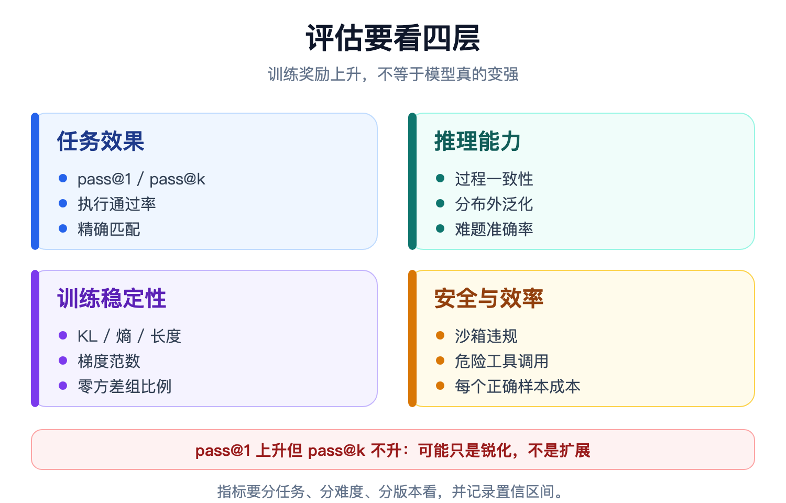
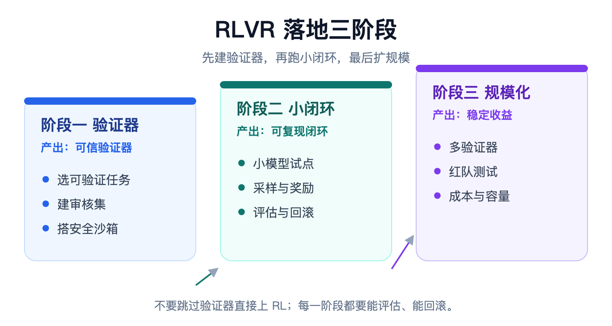

# RLVR 技术详解（四）：评估、误区与落地建议

> 训练奖励上升，不等于模型真的变强
>
> 适合读者：准备把 RLVR 落到工程系统的团队

前三篇讲了原理、流程和任务实现。

最后一篇讲三件事：怎么评估，哪些坑最容易踩，以及一个团队应该按什么顺序落地。

先说一个反直觉的结论：

训练奖励持续上升，可能是模型真的变强，也可能是模型学会了利用验证器。

所以 RLVR 的评估，不能只看 reward。

## 01 | 评估：不只看准确率

任务效果至少要看四类指标。

| 指标 | 看什么 | 注意 |
| --- | --- | --- |
| Pass@1 | 单次回答正确率 | 最接近线上体验 |
| Pass@k | k 次采样至少一次正确 | 看能力覆盖，不只看命中 |
| 执行通过率 | 代码/工具是否跑通 | 区分编译、运行、超时 |
| 精确匹配 | 答案是否一致 | 先归一化，否则误判 |

推理能力还要看：

- 答案和过程是否一致；
- 换数字、换问法后是否还能做对；
- 高难度题和分布外题目的表现；
- 多次采样投票相对单次的提升。

训练稳定性看：

- reward 均值和方差；
- KL 散度；
- 熵和输出长度；
- 梯度范数；
- 全对/全错组比例。

安全指标看：

- 不安全输出比例；
- 沙箱违规比例；
- 危险工具调用比例；
- 格式漏洞利用比例。

工程效率看：

- rollout 吞吐；
- 验证延迟；
- 每个正确样本的成本；
- GPU 利用率；
- 执行失败率。

其中最重要的是 pass@1 和 pass@k 一起看。

pass@1 上升，说明模型更容易一次做对。

pass@k 不升，说明模型可能只是把已有能力“锐化”了，而不是扩展了能力边界。

如果只看训练奖励和单一基准的 pass@1，很容易高估 RLVR 的效果。

*图 7：任务、推理、稳定性、安全与效率，四层一起看。*

## 02 | 优势与局限

RLVR 的优势很明确。

奖励客观，尤其在数学、代码、结构化输出上。

自动化程度高，可以随采样规模扩展。

适合推理任务，支持“多探索 + 可靠筛选”。

减少人工偏好标注依赖，测试和规则可以复用。

可以和代码执行、SQL、工具环境结合，让奖励更接近真实任务。

但局限同样明确。

| 局限 | 技术原因 | 工程建议 |
| --- | --- | --- |
| 只适合可验证任务 | 开放式写作难有唯一判据 | 与 RLHF/RLAIF 组合 |
| 验证器决定上限 | 假阳性会被策略放大 | 建审核集，测 precision |
| 奖励稀疏 | 难题组内全错，无梯度 | 课程学习、动态采样 |
| 可能 reward hacking | 程序有边界和漏洞 | 隐藏测试、红队、多验证器 |
| 训练成本高 | 采样、验证、RL 都贵 | 小模型试点、缓存、预算 |
| 沙箱复杂 | 执行不可信代码 | 微虚拟机、网络隔离、审计 |
| 可能牺牲多样性 | 策略收敛到高奖励模式 | KL、熵监控、风格回归 |

一句话：RLVR 擅长“正确性”，不擅长“讨喜”。

不要指望一个奖励函数同时解决正确、风格、安全、创造力和成本。

## 03 | 十个常见误区

| 误区 | 为什么危险 | 正确做法 |
| --- | --- | --- |
| 有 verifier 就能训好 | 验证器可能漏判、误判 | 先测覆盖率和准确率 |
| 只看最终答案 | 猜中、枚举也会得分 | 加过程检查和扰动测试 |
| 只用二值奖励 | 难题上全是 0 | 课程学习、分级或过程奖励 |
| 公开测试泄漏 | 模型过拟合样例 | 隐藏测试、随机测试 |
| 忽略 KL | 策略漂移、语言退化 | 监控 KL、熵、长度 |
| 忽略 hacking | 奖励上升但能力下降 | 红队、多验证器、抽检 |
| 把 Judge 当真理 | 主观偏差、提示注入 | 规则优先、多裁判、校准 |
| 不做 held-out | 指标虚高，无法判断泛化 | 按来源/时间去重切分 |
| 没有沙箱 | 代码逃逸、密钥泄漏 | 微虚拟机、网络隔离 |
| 认为能替代 RLHF | 语气、安全难以规则化 | 组合使用，按任务路由 |

这些误区的共同根源，是把“奖励信号”当成了“任务目标”。

验证器只是目标的代理。代理和真实目标之间永远有缝隙。

工程上要做的，是持续测量缝隙，而不是假设它不存在。

## 04 | 未来趋势

第一，从结果奖励走向过程奖励。

过程奖励能告诉模型哪一步错了，更适合长链推理。难点是步骤边界、标注成本和过程奖励被利用。

第二，验证器会更强、更组合化。

语法检查、类型检查、单元测试、属性测试、符号计算、SMT、形式化证明，会按成本和置信度分层组合。

第三，与形式化方法结合。

Lean、Coq、Isabelle 提供最高置信度。瓶颈在自动形式化：把自然语言题目转成形式化规约。

第四，与 Agent 环境结合。

文件系统、数据库、API、浏览器、代码仓库，都是可验证环境。关键挑战是保真度、长程信用分配和安全隔离。

第五，多验证器集成。

单一验证器容易被针对。投票、交叉检查、置信度加权，可以降低单点偏差，代价是成本上升。

第六，代码与数学联合训练。

两者都需要精确推理、分步验证和错误回溯，可能互相迁移。数据配比和负迁移需要实验。

第七，RLVR 与合成数据闭环。

强模型生成题目、答案和测试，验证器筛选，再用于训练。要防止重复、有偏和评测污染。

第八，更稳定高效的 RL 算法。

动态采样、clip-higher、token 级损失、长度塑形、异步 rollout，都是围绕“更稳、更省、更长”优化。

第九，安全对齐与可验证奖励结合。

权限、格式、工具调用约束可以写成规则，作为硬约束或强惩罚并入训练。难点是避免过度拒答和规则冲突。

第十，从单轮任务走向长程任务。

多轮对话、多步工具调用、跨文件代码修改、长期 Agent 任务，都需要检查过程、终态、资源消耗和安全边界。

最后，有一类研究值得保持关注：

RL 后的模型 pass@1 更高，但在更大采样预算下，pass@k 是否真的超过基座模型？

如果 RL 只是让模型更稳定地采样到已有正确解，而不是学会全新能力，那么“提升推理能力”的表述就需要更精确。

这些结论仍有争议，但它们提醒我们：评估要看 pass@k、看分布外、看基座对照。

## 05 | 给工程团队的落地建议

*图 8：先建验证器，再跑小闭环，最后扩规模。*

1. 先从天然可验证的任务开始：数学、单测代码、JSON、SQL、工具调用。
2. 先用小模型和小数据验证闭环，再扩大规模。
3. Verifier 优先于 Trainer：先有审核集、误判率和沙箱。
4. 代码执行必须强隔离：无网络、只读文件系统、资源限制、审计。
5. 使用隐藏测试，定期轮换，防止过拟合。
6. 对奖励做可视化和审计：分项分布、极值样本、异常模式。
7. 保留 held-out 测试集，按来源或时间去重。
8. 用 KL 控制防止模型退化，监控熵、长度和重复率。
9. 对 reward hacking 做红队测试，不要等上线后才发现。
10. 同时评估正确率、稳定性、安全性和成本。
11. 不要把 LLM Judge 当成唯一奖励来源。
12. 建立实验追踪和 checkpoint 回滚机制。
13. 验证服务与训练集群分域部署，按最小权限运行。
14. 区分模型错误和验证器错误，使用三态结果。
15. 为验证成本做预算，计算“每个正确样本的成本”。

如果只能记一句话：

RLVR 的价值，不在于“自动提升智能”，而在于把正确性变成一个可以大规模优化、也可以大规模审计的目标。

*系列完*

## 参考文献

1. Lambert, N., et al. Tülu 3: Pushing Frontiers in Open Language Model Post-Training. arXiv:2411.15124, 2024.
2. Shao, Z., et al. DeepSeekMath: Pushing the Limits of Mathematical Reasoning in Open Language Models. arXiv:2402.03300, 2024.
3. DeepSeek-AI. DeepSeek-R1: Incentivizing Reasoning Capability in LLMs via Reinforcement Learning. arXiv:2501.12948, 2025.
4. Yu, Q., et al. DAPO: An Open-Source LLM Reinforcement Learning System at Scale. arXiv:2503.14476, 2025.
5. Yue, Y., et al. Does Reinforcement Learning Really Incentivize Reasoning Capacity in LLMs Beyond the Base Model? arXiv:2504.13837, 2025.
6. Spurious Rewards: Rethinking Training Signals in RLVR. arXiv:2506.10947, 2025.
7. Setlur, A., et al. Rewarding Progress: Scaling Automated Process Verifiers for LLM Reasoning. arXiv:2410.08146, 2024.
8. Yang, K., et al. LeanDojo: Theorem Proving with Retrieval-Augmented Language Models. arXiv:2306.15626, 2023.
